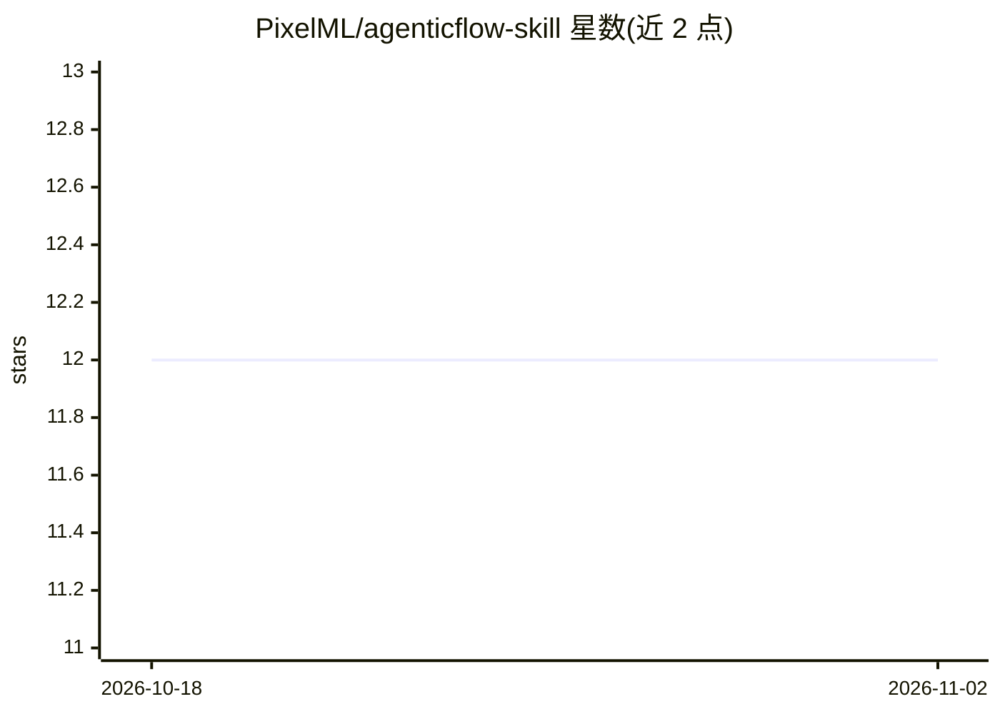

# PixelML/agenticflow-skill

⭐ 12 · JavaScript · 推送 2026-07-07 · [GitHub](https://github.com/PixelML/agenticflow-skill) · [官网](https://agenticflow.ai) · 组织维护

**让 AI 编码助手操作 AgenticFlow 平台的 Claude 技能插件**

AgenticFlow 官方工具包，以 Claude skill/插件形式为 Claude Code、Cursor、Gemini CLI、OpenAI Codex 等编码代理提供接入能力：构建 AI agent、部署多 agent workforce、检查与挂载 MCP 工具提供方，操作通过 af CLI 完成。包含三个按提示词自动路由的技能（workforce/agent/mcp），依赖 Node.js 18+ 与 af CLI，需在 app.agenticflow.ai 获取 API key 认证。同仓库的独立 MCP server 被标注为不推荐使用。

## 筛选速览

| 维度 | 判定 | 备注 |
|---|---|---|
| AI 角色 | `ai-ecosystem` | LLM/agent 周边工具 |
| 许可风险 | `permissive` | — |
| 部署形态 | `library` | 以包/库形式分发 |
| 模型依赖 | — | README 未给出锁定关系 |
| 硬件要求 | — | 无带数字的原话,不猜 |
| 安装摩擦 | `low` | 无编译、无系统依赖或容器化 |
| 成熟度 | — | 结构信号不足 |

## 能力要点

- 三个技能按提示词自动路由：workforce 部署、agent 构建、MCP 挂载
- 通过 af CLI 操作平台：bootstrap、agent、workforce、mcp-clients 子命令
- 支持 Claude Code 插件市场、Cursor、Gemini CLI、Codex、VS Code 多种安装途径
- 插件随 CLI 能力更新自动传播

## 适用场景

- 在 Claude Code 中用自然语言创建和迭代 AgenticFlow agent
- 部署多 agent workforce 并发布公开 URL
- 为 agent 检查与挂载 MCP 工具（Google Sheets、Notion、Slack 等）

## 场景标签

`Agent 框架` `多智能体` · 领域:Agent 开发

## 证据(README 行号)

> L3: > Connect your AI tools to the AgenticFlow platform.
> L5: The toolkit gives your agent (Claude Code, OpenAI Codex, Cursor, Gemini CLI, …) access to AgenticFlow: build AI agen
> L65: |Skill|When it fires|What it covers|

## 星数曲线

2026-10-18 12 → 2026-11-02 12（+0）

---
*卡片 v1 · prompt 1.4 · 生成 2026-11-01 · 置信度 mid · 依据 README sha `9748dc1d0660` · [字段定义](../../DATASET.md)*
