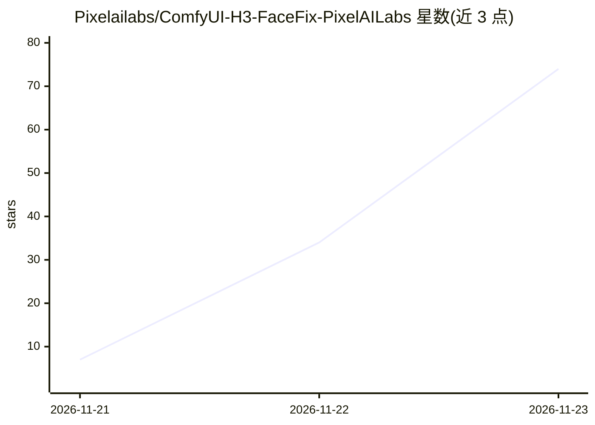

# Pixelailabs/ComfyUI-H3-FaceFix-PixelAILabs

⭐ 74 · Python · MIT · 推送 2026-11-19 · [GitHub](https://github.com/Pixelailabs/ComfyUI-H3-FaceFix-PixelAILabs) · [官网](https://pixelailabs.com) · 组织维护

**ComfyUI 工作流+节点：修复 MiniMax H3 视频中的远景人脸**

为 ComfyUI 提供的自定义节点与工作流，用于处理 MiniMax H3 生成视频中远离镜头出现的脸部模糊问题：工作流跟踪每帧人脸、用 SAM 3.1 生成遮罩、以用户提供的角色照片在 768px 尺度重绘人脸，再只把人脸贴回原视频，保留原始音频，不重新渲染整段视频。自带的 H3 Face Size Fade 节点按人脸像素高度决定修复强度，110px 以下全量修复、180px 以上保持原样。单次运行仅处理一张脸，多人需多次运行。

## 筛选速览

| 维度 | 判定 | 备注 |
|---|---|---|
| AI 角色 | `ai-native` | 本体是模型或模型工具 |
| 许可风险 | `permissive` | MIT |
| 部署形态 | `None` |  |
| 模型依赖 | — | README 未给出锁定关系 |
| 硬件要求 | — | 无带数字的原话,不猜 |
| 安装摩擦 | `low` | 无编译、无系统依赖或容器化 |
| 成熟度 | — | 结构信号不足 |

## 能力要点

- H3 Face Size Fade 节点：按人脸像素大小（110/180px 阈值）平滑调节修复强度
- 跟踪人脸、SAM 3.1 遮罩、768px 无提示词重绘、仅人脸贴回，保留原音频
- 支持 largest_face/smallest_face 选择及 Face number 处理多人场景
- 提供 example_workflows 工作流 JSON，节点无需额外 Python 包

## 适用场景

- 修复已生成的 H3 视频中远景人物的糊脸问题
- 多人视频中对不同人物逐次运行人脸修复
- 希望保持特写镜头不被改动、只处理远景帧

## 场景标签

`图像视频处理` · 领域:感知与多模态

## 证据(README 行号)

> L3: ### Fix melted, blurry far faces in MiniMax H3 videos. No re-render, original audio kept.
> L5: MiniMax H3 smudges faces that are far from the camera. This workflow finds the face, redraws it big with your
> L93: **H3 Face Size Fade (PixelAI Labs)** sits between *H3 Face Track Crop* and *H3 Face Stitch*. Faces at or under 110 

## 星数曲线

2026-11-21 7 → 2026-11-23 74（+67）

---
*卡片 v1 · prompt 1.4 · 生成 2026-11-21 · 置信度 high · 依据 README sha `70c22bcdbd71` · [字段定义](../../DATASET.md)*
