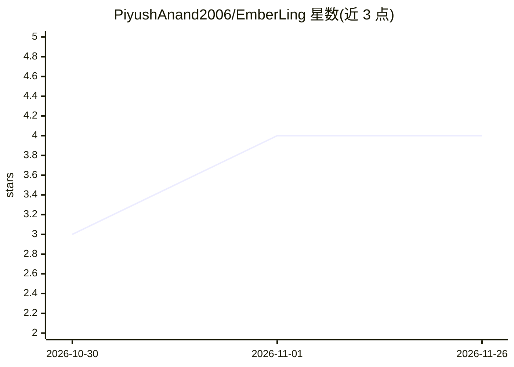

# PiyushAnand2006/EmberLing

⭐ 4 · JavaScript · MIT · 推送 2026-11-21 · [GitHub](https://github.com/PiyushAnand2006/EmberLing) · [官网](https://github.com/PiyushAnand2006/EmberLing/releases) · 个人维护

**Windows 桌面 AI agent：聊天、工具调用、自动化与 bot 发布，免 API key 运行**

基于 Electron + React 的桌面 AI agent，功能包括 iMessage 风格聊天、37 个核心工具 + 38 个集成工具、MCP stdio 服务器接入、LAN 发布 bot、定时自动化、语音模式与记忆。核心机制：agent 循环最多 24 步，多 provider 回退链，默认 Pollinations 无需 API key 即可运行；工具执行带审批门控，可路由到本机、WSL 沙盒 VM 或 SSH 远程主机。仅支持 Windows，提供 NSIS 安装包与便携版，从源码运行需 Node 18+。项目声明由对商业应用的逆向重建而来，仅供学习与 hackathon 使用。

## 筛选速览

| 维度 | 判定 | 备注 |
|---|---|---|
| AI 角色 | `ai-native` | 本体是模型或模型工具 |
| 许可风险 | `permissive` | MIT |
| 部署形态 | `desktop` | 安装包/桌面程序 |
| 模型依赖 | — | README 未给出锁定关系 |
| 硬件要求 | — | 无带数字的原话,不猜 |
| 安装摩擦 | `low` | 无编译、无系统依赖或容器化 |
| 成熟度 | — | 结构信号不足 |

## 能力要点

- 默认 Pollinations provider 无需 API key 即可聊天并调用工具
- 37 个核心工具 + 38 个集成工具，密钥 DPAPI 加密、不暴露给模型
- WSL 沙盒 VM / SSH 远程 / 本机三种工具执行目标，带审批门控
- MCP stdio 服务器接入，bot 可发布为带访问控制的 web 聊天

## 适用场景

- 在 Windows 桌面通过自然语言让 agent 执行文件、shell、浏览器操作
- 接入 GitHub/Slack/邮件等服务让 agent 自动化日常工作流
- 创建并发布个人或团队 bot，配置定时自动化任务
- 无 API key 的环境下体验 agent 工具调用能力

## 场景标签

`工作流自动化` `聊天机器人` `AI 助手` `浏览器自动化` · 领域:效率与自动化

## 证据(README 行号)

> L7: **EmberLing** is a desktop AI agent for Windows — chat, tools, bots, automations, MCP, voice, publishing — rebuilt f
> L44: The renderer crosses a contextIsolation IPC boundary into the Electron main process — a pure dispatcher: the agent 

## 星数曲线

2026-10-30 3 → 2026-11-26 4（+1）

---
*卡片 v1 · prompt 1.4 · 生成 2026-11-21 · 置信度 high · 依据 README sha `312cc03a86a0` · [字段定义](../../DATASET.md)*
