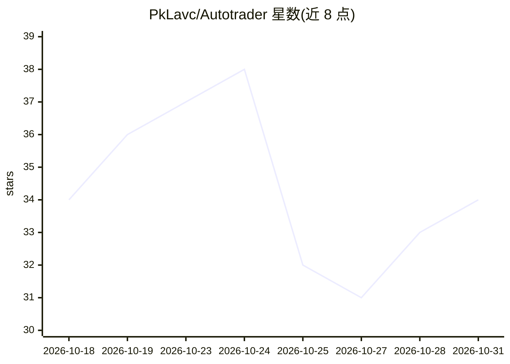

# PkLavc/Autotrader

⭐ 34 · Python · MIT · 推送 2026-10-30 · [GitHub](https://github.com/PkLavc/Autotrader) · [官网](https://pklavc.com/Autotrader) · 个人维护

**基于 Kronos 金融模型的全自动市场预测与模拟盘交易系统**

以 Kronos 金融基础模型（默认 NeoQuasar/Kronos-base）驱动的自主交易研究平台：每日美股收盘后由 GitHub Actions 工作流下载固定版本模型、生成预测信号、按波动率调整评分排序后写入独立的研究账本，并可通过 Alpaca 纸面模式执行受门控的经纪商订单。内置多项安全与正确性约束：拒绝 16:15 前的不完整 K 线、拒绝超出合理区间的预测、多级 opt-in 才能开启实盘。默认为纸面交易，经纪商执行需显式配置凭证与安全门。

## 筛选速览

| 维度 | 判定 | 备注 |
|---|---|---|
| AI 角色 | `ai-native` | 本体是模型或模型工具 |
| 许可风险 | `permissive` | MIT |
| 部署形态 | `library` | 以包/库形式分发 |
| 模型依赖 | — | README 未给出锁定关系 |
| 硬件要求 | — | 无带数字的原话,不猜 |
| 安装摩擦 | `low` | 无编译、无系统依赖或容器化 |
| 成熟度 | — | 结构信号不足 |

## 能力要点

- GitHub Actions 每日自动运行：下载固定版本 Kronos、生成信号、审计状态并提交纸面账本
- 研究与经纪账户分离，会话至多处理一次、同日 K 线延迟至 16:15 ET 后接受
- Alpaca 纸面模式下的长仓、限额、幂等经纪计划执行，实盘需多重独立 opt-in
- 支持点位回放（walk-forward）重放历史预测且避免同 bar 成交

## 适用场景

- 我想每天自动跑 Kronos 模型生成美股预测并记录纸面交易账本
- 我想回放历史点位数据验证策略而不引入同 bar 成交偏差
- 我想在多账户上以受控安全门执行同一验证过的信号

## 场景标签

`金融量化` · 领域:学习与行业

## 证据(README 行号)

> L7: Autonomous daily-market research and guarded broker-execution platform powered by the
> L47: |Model|`NeoQuasar/Kronos-base`|
> L67: `.github/workflows/paper-trade.yml` runs after the US regular session, downloads the pinned

## 星数曲线

2026-10-18 34 → 2026-10-31 34（+0）

---
*卡片 v1 · prompt 1.4 · 生成 2026-10-26 · 置信度 high · 依据 README sha `bc2205e5be14` · [字段定义](../../DATASET.md)*
