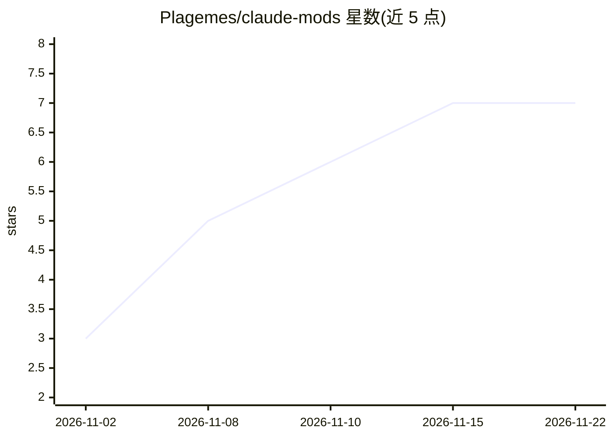

# Plagemes/claude-mods

⭐ 7 · TypeScript · MIT · 推送 2026-10-15 · [GitHub](https://github.com/Plagemes/claude-mods) · [官网](https://plagemes.github.io/claude-mods/) · 个人维护

**为 Claude Code 用户提供 200+ 插件与终端内插件商店**

Claude Mods 是面向 Claude Code 的开源插件集合，包含 219 个基于 function hooks 的小型插件，分 21 个类别：防护栏（拦截写入 API key、危险命令）、状态行、实时面板、agent 控制与栈感知检查。v2 引入共享核心 mods-hub（事件总线、侧边面板、通知路由）、mod-advisor 推荐安装、smart-router 子代理调度等平台组件。通过 Claude Code 的 plugin marketplace 安装，要求 Claude Code 2.1.292 及以上，插件为零配置的 TypeScript 文件夹。

## 筛选速览

| 维度 | 判定 | 备注 |
|---|---|---|
| AI 角色 | `ai-ecosystem` | LLM/agent 周边工具 |
| 许可风险 | `permissive` | MIT |
| 部署形态 | `self-host` | docker 或自建部署 |
| 模型依赖 | — | README 未给出锁定关系 |
| 硬件要求 | — | 无带数字的原话,不猜 |
| 安装摩擦 | `low` | 无编译、无系统依赖或容器化 |
| 成熟度 | — | 结构信号不足 |

## 能力要点

- 219 个插件分 21 类，含 11 个安全防护栏插件
- 内置终端插件商店，支持离线浏览与缓存目录
- mods-hub 事件总线让 165 个插件协同工作
- guardian 提供统一安全策略（宽松/标准/严格）与项目安全评分

## 适用场景

- 阻止 Claude Code 在编辑中写入 API key 或执行 rm -rf 等危险命令
- 在状态行查看会话 token 成本与上下文占用
- 按技术栈为项目安装匹配的守护插件
- 在面板中查看每次工具调用的时长与状态时间线

## 场景标签

`编码 Agent` · 领域:编码与开发

## 证据(README 行号)

> L24: **Claude Mods** is a curated collection of more than 200 open-source mods for Claude Code: small plugins of functio
> L13:  Claude Code plugin marketplace

## 星数曲线

2026-11-02 3 → 2026-11-22 7（+4）

---
*卡片 v1 · prompt 1.4 · 生成 2026-11-20 · 置信度 mid · 依据 README sha `14e3bdee88fe` · [字段定义](../../DATASET.md)*
