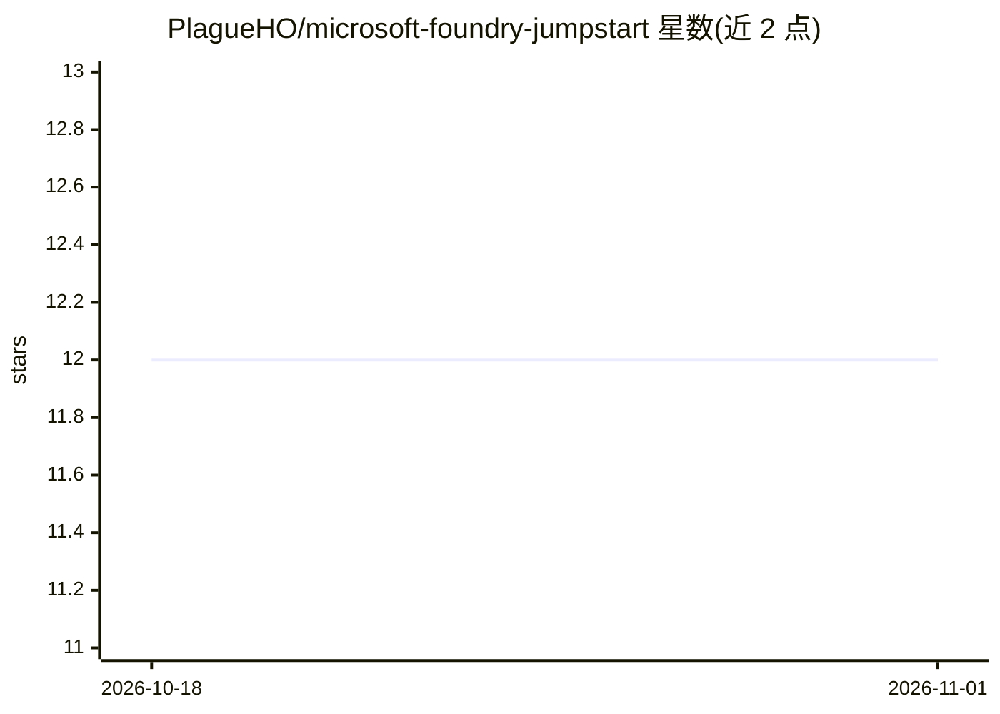

# PlagueHO/microsoft-foundry-jumpstart

⭐ 12 · Python · MIT · 推送 2026-10-23 · [GitHub](https://github.com/PlagueHO/microsoft-foundry-jumpstart) · [官网](https://danielscottraynsford.com/projects/azure-ai-foundry-jumpstart/) · 个人维护

**面向 Azure 订阅的 Microsoft Foundry 零信任环境部署加速器**

通过 Azure Developer CLI（azd）或 Azure Portal 将 Microsoft Foundry 及配套服务部署到 Azure 订阅的解决方案加速器，使用 Bicep Azure Verified Modules 实现 IaC。默认采用零信任配置：虚拟网络、私有端点、禁用公网访问、服务间托管标识认证，也支持非隔离的公共端点部署。可选部署 AI 模型、示例数据、Foundry 项目，并配置诊断日志。需要 Azure 订阅与 azd CLI；.NET 10 SDK 与 Python 3.11+ 仅为运行示例所需。

## 筛选速览

| 维度 | 判定 | 备注 |
|---|---|---|
| AI 角色 | `ai-ecosystem` | LLM/agent 周边工具 |
| 许可风险 | `permissive` | MIT |
| 部署形态 | `desktop` | 安装包/桌面程序 |
| 模型依赖 | — | README 未给出锁定关系 |
| 硬件要求 | — | 无带数字的原话,不猜 |
| 安装摩擦 | `medium` | 含编译或系统依赖之一 |
| 成熟度 | — | 结构信号不足 |

## 能力要点

- 默认零信任：虚拟网络+私有端点+禁用公网+托管标识认证
- 基于 Bicep Azure Verified Modules 的 IaC 自动化部署
- 可选部署 AI 模型、示例数据与 Foundry 项目
- 所有资源配置诊断设置发送日志到 Log Analytics 工作区

## 适用场景

- 在 Azure 中快速搭建安全合规的 Microsoft Foundry 试验环境
- 按零信任/网络隔离要求部署 AI Foundry 资源
- 在 Foundry 中预置模型与示例数据以加速上手

## 场景标签

 · 领域:云基础设施/AI 平台部署

## 证据(README 行号)

> L11: The Microsoft Foundry Jumpstart Solution Accelerator deploys a Microsoft Foundry environment and supporting service
> L19: By default, this solution accelerator deploys Microsoft Foundry and most of the supporting resources into a *virtua

## 星数曲线

2026-10-18 12 → 2026-11-01 12（+0）

---
*卡片 v1 · prompt 1.4 · 生成 2026-11-01 · 置信度 high · 依据 README sha `7e3ce7f1bfd2` · [字段定义](../../DATASET.md)*
