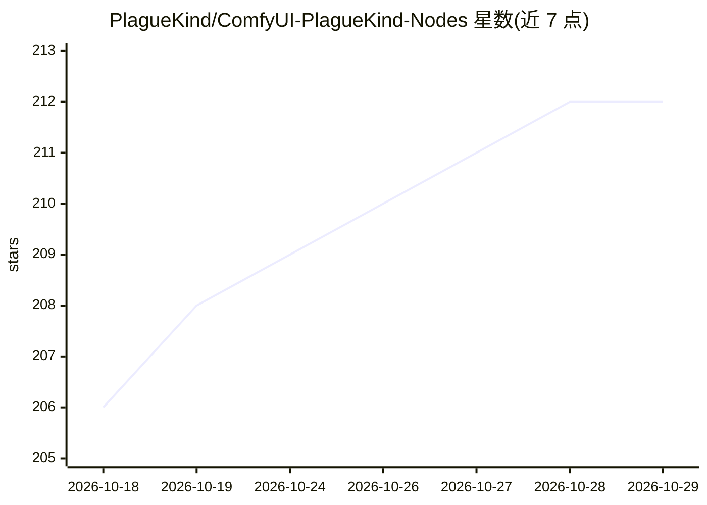

# PlagueKind/ComfyUI-PlagueKind-Nodes

⭐ 212 · Python · MIT · 推送 2026-09-21 · [GitHub](https://github.com/PlagueKind/ComfyUI-PlagueKind-Nodes) · 个人维护

**ComfyUI 自定义节点集：图像/遮罩统一缩放、可视裁剪、LoRA 堆叠与 H3 补丁**

面向 ComfyUI 用户的自定义节点集合，包含四组功能：图像与遮罩的统一缩放节点（多种缩放模式、保持宽高比、整除约束、张量级遮罩变换）；可视化拖拽裁剪节点（宽高比锁定、归一化坐标）；面向 LTX-2.3 的 10 槽 LoRA 堆叠加载器（音视频分支独立强度、兼容 MiniMax-H3 与通用模型）；以及 MiniMax-H3 的块稀疏注意力节点和 AdaLN LoRA 兼容性修复节点。通过 git clone 或 ComfyUI Manager 安装，除标准 ComfyUI 环境外无必需依赖，H3 SLA Attention 需 Triton 与支持的 GPU（缺失时自动回退）。

## 筛选速览

| 维度 | 判定 | 备注 |
|---|---|---|
| AI 角色 | `ai-ecosystem` | LLM/agent 周边工具 |
| 许可风险 | `permissive` | MIT |
| 部署形态 | `None` |  |
| 模型依赖 | — | README 未给出锁定关系 |
| 硬件要求 | — | 无带数字的原话,不猜 |
| 安装摩擦 | `low` | 无编译、无系统依赖或容器化 |
| 成熟度 | — | 结构信号不足 |

## 能力要点

- 图像与遮罩走同一几何管线的统一缩放节点，支持整除约束适配 LTX-2.3/SDXL
- 可视化拖拽裁剪节点，宽高比锁定与归一化坐标
- 10 槽 LoRA 堆叠加载器，音/视频分支独立强度控制（LTX-2.3、MiniMax-H3、通用模型）
- MiniMax-H3 块稀疏注意力与 AdaLN LoRA 兼容性修复，实测报告 1.4–1.75x 提速

## 适用场景

- 修复 ComfyUI 工作流中图像与遮罩缩放不一致导致的 inpainting 对齐问题
- 在节点上直接拖拽选择裁剪区域并复用
- 为 LTX-2.3 音视频扩散管线做多 LoRA 分支强度控制
- 让稠密 MiniMax-H3 LoRA 在剪枝检查点上生效并获得干净日志

## 场景标签

`图像视频处理` · 领域:感知与多模态

## 证据(README 行号)

> L3: ComfyUI custom nodes providing unified image and mask resizing with multiple scaling modes, aspect-ratio preservatio
> L7: A single ComfyUI node that ensures consistent resizing behavior between images and masks using a unified geometric p
> L170: git clone https://github.com/PlagueKind/ComfyUI-PlagueKind-Nodes.git

## 星数曲线

2026-10-18 206 → 2026-10-29 212（+6）

---
*卡片 v1 · prompt 1.4 · 生成 2026-10-22 · 置信度 high · 依据 README sha `43a8b20a59da` · [字段定义](../../DATASET.md)*
