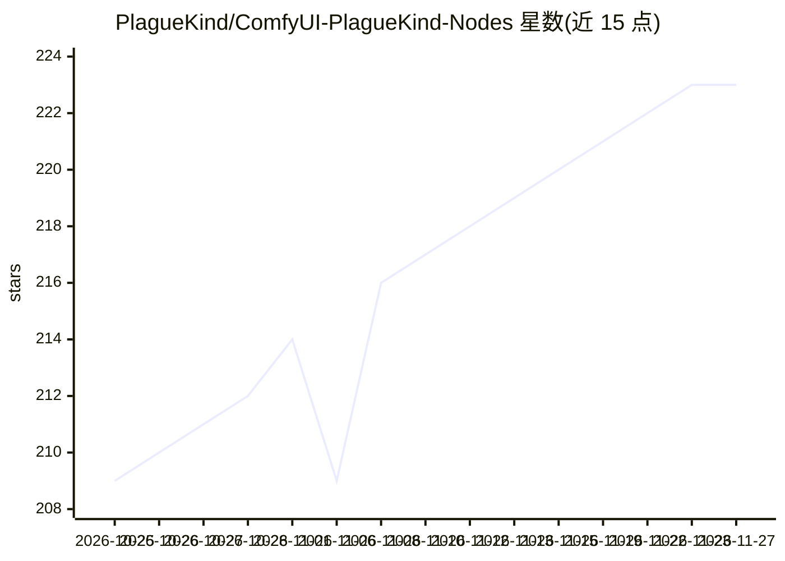

# PlagueKind/ComfyUI-PlagueKind-Nodes

⭐ 223 · Python · MIT · 推送 2026-11-26 · [GitHub](https://github.com/PlagueKind/ComfyUI-PlagueKind-Nodes) · 个人维护

**面向 ComfyUI 的图像/遮罩处理与 MiniMax H3 视频工作流节点包**

为 ComfyUI 提供一组自定义节点：统一的图像/遮罩缩放管线（多种缩放模式、宽高比预设、中心裁剪、整除约束）、可视化 BBox 裁剪、10 槽 LoRA 堆叠加载器（含 LTX/MiniMax 分支拆分模式）、RefMod 加载器、多文件媒体加载器与 Bundle 传递节点，以及面向 MiniMax H3 的参考图/视频到视频提示编码器和块稀疏注意力（SLA）补丁。除标准 ComfyUI 安装外无外部依赖，可选组件缺失时降级为警告而非阻断启动。

## 筛选速览

| 维度 | 判定 | 备注 |
|---|---|---|
| AI 角色 | `ai-ecosystem` | LLM/agent 周边工具 |
| 许可风险 | `permissive` | MIT |
| 部署形态 | `None` |  |
| 模型依赖 | — | README 未给出锁定关系 |
| 硬件要求 | — | 无带数字的原话,不猜 |
| 安装摩擦 | `medium` | 含编译或系统依赖之一 |
| 成熟度 | — | 结构信号不足 |

## 能力要点

- 图像与遮罩走同一几何变换管线，提供 5 种缩放模式与整除约束
- 节点上直接拖拽的可视化裁剪框，支持比例锁定与归一化坐标
- LoRA 堆叠加载器按 video/audio/text 模态拆分强度，最多 10 槽
- MiniMax H3 块稀疏注意力补丁，sparsity_ratio 与 block_size 可调

## 适用场景

- 为 LTX-2.3 / SDXL / MiniMax H3 视频生成工作流准备尺寸一致的图像与遮罩
- 在节点图上直接框选裁剪区域并接续缩放管线
- 同时管理多张参考图、参考视频与音频输入的 H3 参考到视频编码
- 对 H3 推理做稀疏注意力加速并控制最后若干步为稠密计算

## 场景标签

`图像生成` `视频生成` `图像视频处理` · 领域:内容生成

## 证据(README 行号)

> L3: ComfyUI custom nodes for MiniMax H3 (and general) video workflows: unified image/mask resizing and visual crop tools
> L5: The pack loads with no external dependencies beyond a standard ComfyUI install; every optional part degrades with a 

## 星数曲线

2026-10-25 209 → 2026-11-27 223（+14）

---
*卡片 v1 · prompt 1.4 · 生成 2026-11-25 · 置信度 mid · 依据 README sha `18570bb0f38a` · [字段定义](../../DATASET.md)*
