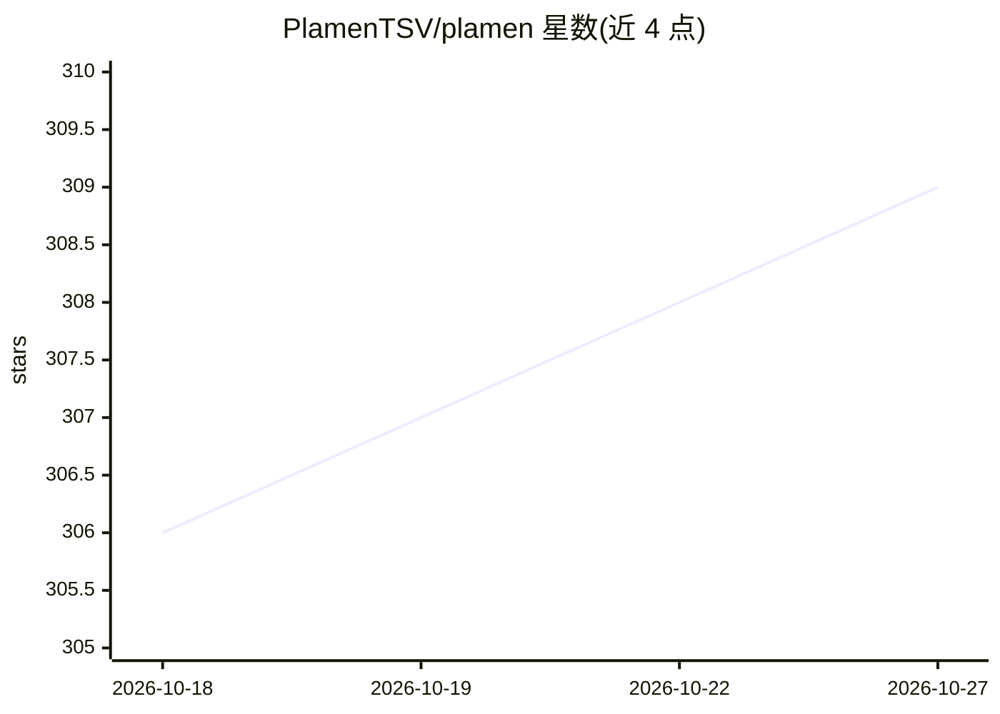

# PlamenTSV/plamen

⭐ 309 · Python · MIT · 推送 2026-09-26 · [GitHub](https://github.com/PlamenTSV/plamen) · 个人维护

**面向 Claude Code/Codex CLI 的 Web3 安全审计多 Agent 编排器**

Plamen 是运行在 Claude Code 或 OpenAI Codex CLI 之上的自主 Web3 安全审计工具：编排 18-100 个 AI agent、40+ 阶段，对智能合约（EVM/Solidity、Solana/Anchor、Aptos/Sui Move、Soroban、DAML 等）与 L1 节点客户端产出含已验证 PoC 的 AUDIT_REPORT.md。安装器通过符号链接把 agents、规则、提示词注入 ~/.claude 或 ~/.codex；后端 CLI 至少装一个（推荐 Claude Code），各链工具链由 plamen setup 自动安装，可选 RAG 漏洞库构建需约 6GB RAM。支持 Linux/macOS/Windows。

## 筛选速览

| 维度 | 判定 | 备注 |
|---|---|---|
| AI 角色 | `ai-native` | 本体是模型或模型工具 |
| 许可风险 | `permissive` | MIT |
| 部署形态 | `library` | 以包/库形式分发 |
| 模型依赖 | locked-api |  |
| 硬件要求 | — | 无带数字的原话,不猜 |
| 安装摩擦 | `low` | 无编译、无系统依赖或容器化 |
| 成熟度 | — | 结构信号不足 |

## 能力要点

- 编排 18-100 个 AI agent、40+ 阶段产出含已验证 PoC 的审计报告
- 覆盖 EVM/Solana/Aptos/Sui/Soroban/DAML 及 L1 Go/Rust 节点客户端
- 双后端支持：Claude Code 与 OpenAI Codex CLI（含 MCP server 配置合并）
- plamen setup 自动安装 Foundry、Solana CLI 等各链工具链

## 适用场景

- 对 Solidity/Move 等智能合约项目跑自动化安全审计
- 审计 L1 节点客户端（Go/Rust）基础设施代码
- 在已用 Claude Code 或 Codex CLI 的工作流中直接调用 /plamen 审计

## 场景标签

`多智能体` `网络安全` · 领域:Agent 开发

## 证据(README 行号)

> L3: Autonomous Web3 security auditor for Claude Code and OpenAI Codex CLI.
> L5: Orchestrates 18-100 AI agents across 40+ phases to produce audit reports with verified PoC exploits — for **smart co

## 星数曲线

2026-10-18 306 → 2026-10-27 309（+3）

---
*卡片 v1 · prompt 1.4 · 生成 2026-10-21 · 置信度 mid · 依据 README sha `f811ede290e5` · [字段定义](../../DATASET.md)*
