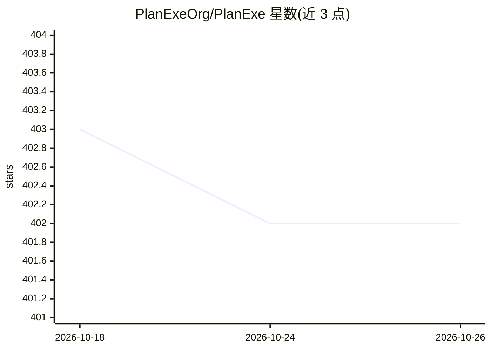

# PlanExeOrg/PlanExe

⭐ 402 · Python · MIT · 推送 2026-10-25 · [GitHub](https://github.com/PlanExeOrg/PlanExe) · [官网](https://planexe.org) · 组织维护

**把项目简述转化为可编辑项目计划基线的本地规划工具**

面向需要规划复杂多阶段项目的人员与 AI agent：用自然语言描述项目后，PlanExe 生成结构化的首轮计划基线，包含假设、决策、工作分解与甘特图、风险登记册、SWOT、事前验尸等内容，输出为可检查、可编辑的 Markdown/JSON/CSV 文件组合。模型调用经 Claude Code CLI 走 Claude 订阅，需 Python 3.11 环境本地运行，无托管服务。本仓库为 v1，README 指引新计划使用 PlanExe v2；生成内容为草稿，不替代专业审查与利益相关方参与。

## 筛选速览

| 维度 | 判定 | 备注 |
|---|---|---|
| AI 角色 | `ai-native` | 本体是模型或模型工具 |
| 许可风险 | `permissive` | MIT |
| 部署形态 | `None` |  |
| 模型依赖 | locked-api |  |
| 硬件要求 | — | 无带数字的原话,不猜 |
| 安装摩擦 | `low` | 无编译、无系统依赖或容器化 |
| 成熟度 | — | 结构信号不足 |

## 能力要点

- 从多个规划视角生成自包含交互式报告（WBS、甘特图、风险登记册、SWOT、事前验尸等）
- 每次运行产生可读源工件文件夹，可编辑中间文件并仅重建受影响部分
- 本地运行，计划以文件形式保存在自有磁盘，可中断恢复
- 模型调用通过 Claude Code CLI 使用用户的 Claude 订阅

## 适用场景

- 为基础设施、医疗、金融等复杂多阶段项目生成首轮计划基线
- 资源有限的组织在获得专业顾问前起草雄心方案
- 检查并迭代计划背后的假设与早期决策

## 场景标签

 · 领域:项目管理/AI 规划

## 证据(README 行号)

> L27: complex projects. Describe a project in plain language and PlanExe creates a
> L54: Claude Code CLI, using your Claude subscription.

## 星数曲线

2026-10-18 403 → 2026-10-26 402（-1）

---
*卡片 v1 · prompt 1.4 · 生成 2026-10-21 · 置信度 high · 依据 README sha `5f890ca7eb03` · [字段定义](../../DATASET.md)*
