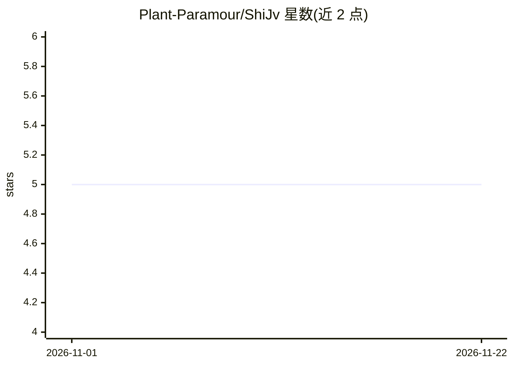

# Plant-Paramour/ShiJv

⭐ 5 · Python · 推送 2026-11-01 · [GitHub](https://github.com/Plant-Paramour/ShiJv) · 个人维护 · 中文 README

**给古典诗词创作者：本地大模型按格律生成与校验诗词**

集格律诗词生成、辅助创作、格律校验、词谱查询与图片导出于一体的桌面工具。核心机制是在本地运行的自回归模型每一步选字时直接排除不符合格律的候选，从而无需额外训练即可按指定诗体、词牌和韵书生成；Agent 参与讨论创作、查词谱韵书、整理创作方案并核对格律。提供图形界面安装向导与启动器，无需命令行；不配置 API 也可使用，格律检测无需模型。

## 筛选速览

| 维度 | 判定 | 备注 |
|---|---|---|
| AI 角色 | `ai-native` | 本体是模型或模型工具 |
| 许可风险 | `none` | — |
| 部署形态 | `desktop` | 安装包/桌面程序 |
| 模型依赖 | — | README 未给出锁定关系 |
| 硬件要求 | — | 无带数字的原话,不猜 |
| 安装摩擦 | `medium` | 含编译或系统依赖之一 |
| 成熟度 | — | 结构信号不足 |

## 能力要点

- 生成时逐步排除不合平仄/押韵的候选字，无需额外训练模型
- Agent 辅助：查词谱韵书、整理创作方案、核对格律与讨论修改
- 格律检测、词谱查询无需配置模型即可使用
- 图形化安装向导与启动器，本地运行，数据保存在本机

## 适用场景

- 不懂格律也能按七律/词牌写出合律的诗词并边创作边学习
- 对已有诗句指定改写或让 AI 补完成完整作品
- 校验作品字数、平仄、韵脚是否符合韵书要求

## 场景标签

`AI 写作` `AI 助手` · 领域:对话与助手

## 证据(README 行号)

> L29: 诗矩将字数、句读、平仄和押韵规则用于生成过程，**希望更多的通用自回归模型无需额外训练，就能按指定诗体、宋词词牌和韵书进行创作。**
> L35: 你可以先和 Agent 聊想写什么，一起斟酌情绪、意象和用韵。它会调用工具查词谱、查韵书，把讨论整理成可编辑的创作方案；你检查并提交后，由本地模型按格律生成正文。
> L41: **接了 API，为什么还要运行本地模型？** 诗矩需要在模型每一步选字时，直接排除不符合格律的候选。普通对话 API 不开放这一层控制，因此仍需在本地运行模型。

## 星数曲线

2026-11-01 5 → 2026-11-22 5（+0）

---
*卡片 v1 · prompt 1.4 · 生成 2026-11-21 · 置信度 high · 依据 README sha `2e053ae00b2f` · [字段定义](../../DATASET.md)*
