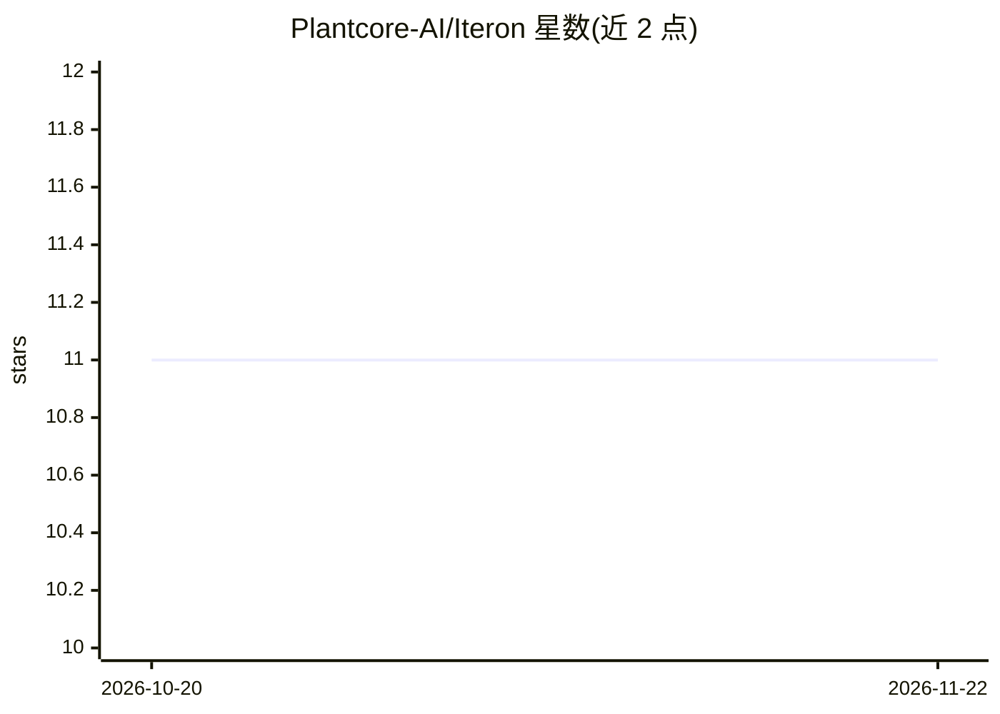

# Plantcore-AI/Iteron

⭐ 11 · Rust · Apache-2.0 · 推送 2026-11-15 · [GitHub](https://github.com/Plantcore-AI/Iteron) · [官网](https://plantcore-ai.github.io/Iteron/) · 组织维护 · 中文 README

**面向开发者的 Rust 终端编码 agent 运行时与 CLI**

Iteron 是一个用 Rust 编写的开源平台，为特定领域 AI agent 的 harness checkpoint 提供构建、评估与治理能力，包含上下文、工具、策略、权限、证据与 checkpoint 生命周期的模块化运行时契约。首个参考实现是终端编码 agent，提供全屏 TUI 与一次性有界自动化接口，支持回合数、时间、成本、重试等显式上限、持久化会话与哈希链证据，并通过 --ask-permissions、--confine（macOS Seatbelt / Linux bubblewrap）约束权限。README 标注项目处于 pre-alpha，存在未解决的符号链接竞态，不适用于无人值守的敏感仓库操作。

## 筛选速览

| 维度 | 判定 | 备注 |
|---|---|---|
| AI 角色 | `ai-ecosystem` | LLM/agent 周边工具 |
| 许可风险 | `permissive` | Apache-2.0 |
| 部署形态 | `desktop` | 安装包/桌面程序 |
| 模型依赖 | locked-api |  |
| 硬件要求 | — | 无带数字的原话,不猜 |
| 安装摩擦 | `low` | 无编译、无系统依赖或容器化 |
| 成熟度 | `idea` | |

## 能力要点

- 模块化 Rust 运行时契约：context、tools、policies、permissions、evidence、checkpoint 生命周期
- 显式资源上限：turns、time、cost、retries、queues、output、concurrency
- macOS Seatbelt 与 Linux bubblewrap 沙箱后端，--ask-permissions 权限规则
- 哈希链本地会话，支持 resume、fork、checkpoint、replay 契约

## 适用场景

- 在终端中以有界自动化方式修复失败的测试并留存验证证据
- 对不信任的仓库以只读 plan 模式解释构建脚本行为
- 为特定模型×任务组合构建和治理专属 agent harness

## 场景标签

`编码 Agent` `Agent 框架` · 领域:Agent 开发

## 证据(README 行号)

> L30: Iteron is an open-source substrate for building, evaluating, and governing
> L31: **harness checkpoints for domain-specific AI agents**. It provides modular Rust runtime
> L33: lifecycle. A terminal coding agent is the first reference implementation, with

## 星数曲线

2026-10-20 11 → 2026-11-22 11（+0）

---
*卡片 v1 · prompt 1.4 · 生成 2026-11-18 · 置信度 high · 依据 README sha `b3656b050e7b` · [字段定义](../../DATASET.md)*
