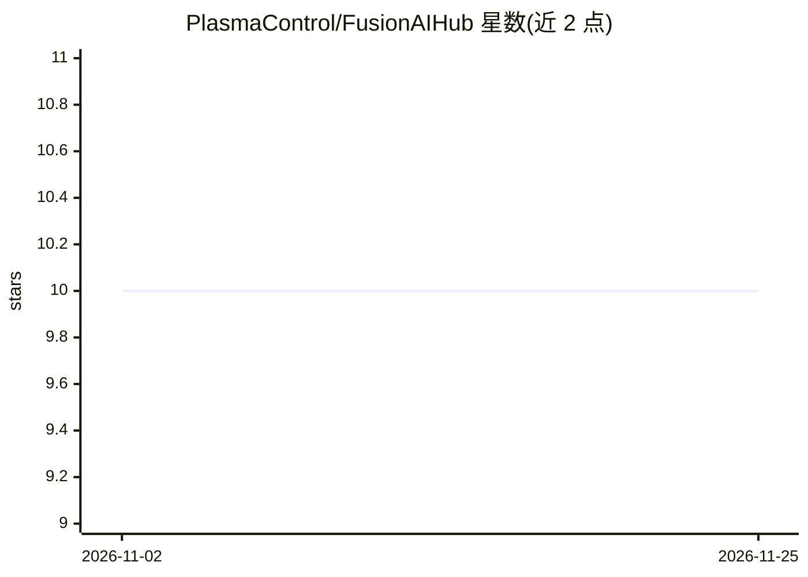

# PlasmaControl/FusionAIHub

⭐ 10 · Python · MIT · 推送 2026-11-23 · [GitHub](https://github.com/PlasmaControl/FusionAIHub) · [官网](https://control.princeton.edu/) · 组织维护

**聚变实验机器学习工作流的训练平台与工具集**

FAITH 是面向聚变（DIII-D 数据）机器学习工作流的集中式平台：用 Pixi 管理环境（替代 Anaconda），支持单 GPU 与多 GPU（DDP）训练模型，默认以离线模式记录 WandB 日志并提供同步命令，另附 Princeton 集群上的作业查询与性能分析流程。数据存储路径指向集群 /scratch 目录，Flash Attention 需按 CUDA/Python/PyTorch 版本匹配预编译 wheel 安装，并要求 GCC ≥9。

## 筛选速览

| 维度 | 判定 | 备注 |
|---|---|---|
| AI 角色 | `ai-native` | 本体是模型或模型工具 |
| 许可风险 | `permissive` | MIT |
| 部署形态 | `library` | 以包/库形式分发 |
| 模型依赖 | — | README 未给出锁定关系 |
| 硬件要求 | — | 无带数字的原话,不猜 |
| 安装摩擦 | `high` | 编译与系统依赖俱全 |
| 成熟度 | — | 结构信号不足 |

## 能力要点

- Pixi 环境管理（curl 安装脚本 + pixi install/shell）
- 单 GPU 与多 GPU DDP 训练
- WandB 默认离线记录，提供 sync 命令
- Flash Attention 预编译 wheel 的版本匹配安装指引

## 适用场景

- 在 Princeton 集群上训练聚变相关模型
- 为 DIII-D 数据准备模型就绪文件
- 多 GPU 环境下的训练日志记录与性能分析

## 场景标签

 · 领域:科研/聚变能机器学习

## 证据(README 行号)

> L1: # Fusion AI Toolkit & Hub (FAITH)
> L25: Models can be trained with either single GPU or multi-GPU (DDP).
> L40: Unprocessed data is stored in `/scratch/gpfs/EKOLEMEN/d3d_fusion_data/`.

## 星数曲线

2026-11-02 10 → 2026-11-25 10（+0）

---
*卡片 v1 · prompt 1.4 · 生成 2026-11-20 · 置信度 low · 依据 README sha `50c64ac98358` · [字段定义](../../DATASET.md)*
