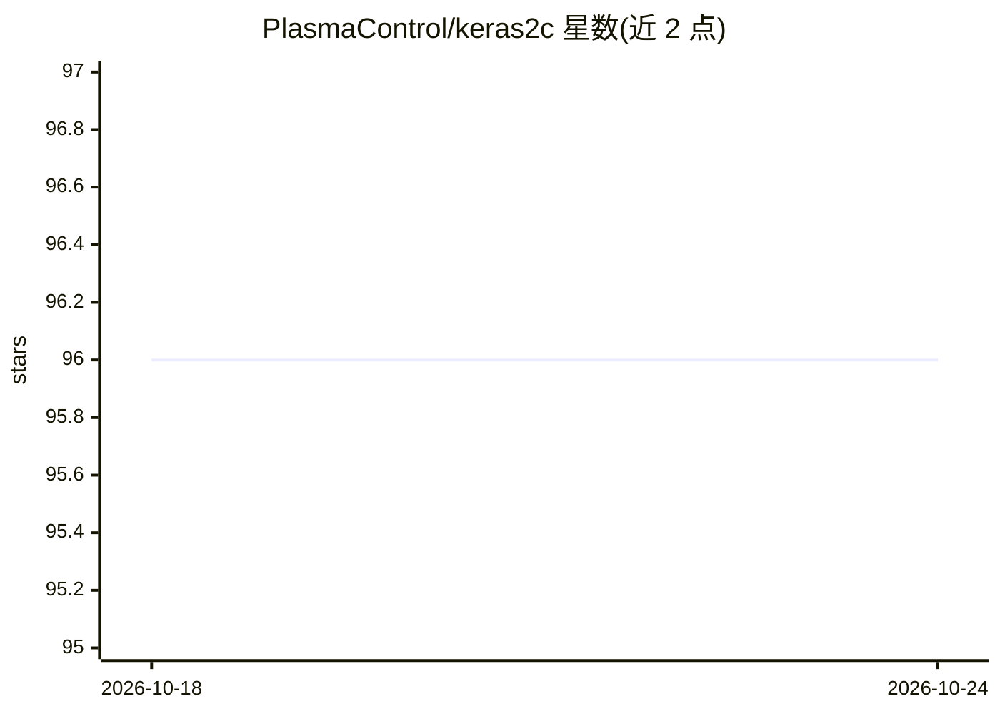

# PlasmaControl/keras2c

⭐ 96 · C · LGPL-3.0 · 推送 2026-05-08 · [GitHub](https://github.com/PlasmaControl/keras2c) · 组织维护

**将 Keras 模型前向推理转换为纯 C99 代码的部署库**

面向实时应用（如等离子体控制等嵌入式场景）的工具库：读取保存的 Keras .h5 模型，将前向推理部分转换为仅依赖标准库的 C99 函数，并自动生成测试。支持 Dense、卷积、池化、RNN（GRU/LSTM）、Embedding、BatchNormalization 等多层类型，部分层（Lambda、SeparableConv 等）尚未支持。可通过 pip 安装，提供命令行与 Python API 两种用法；Windows 需安装 gcc（推荐 CYGWIN）。LGPLv3 许可，附正式发表论文。

## 筛选速览

| 维度 | 判定 | 备注 |
|---|---|---|
| AI 角色 | `ai-ecosystem` | LLM/agent 周边工具 |
| 许可风险 | `viral` | LGPL-3.0 |
| 部署形态 | `library` | 以包/库形式分发 |
| 模型依赖 | — | README 未给出锁定关系 |
| 硬件要求 | — | 无带数字的原话,不猜 |
| 安装摩擦 | `low` | 无编译、无系统依赖或容器化 |
| 成熟度 | — | 结构信号不足 |

## 能力要点

- 将 Keras .h5 模型前向推理转换为仅用标准库的 C99 函数
- 支持 Dense/卷积/池化/RNN（LSTM/GRU）/BatchNormalization 等层类型
- 提供 CLI（python -m keras2c）与 Python API 两种用法，自动生成测试
- 可选动态内存模式，权重保存为 .csv 运行时加载

## 适用场景

- 在无 Python 环境的嵌入式/实时系统上部署已训练的 Keras 模型
- 将神经网络推理集成到 C/C++ 实时控制代码中
- 把模型转为可移植 C 代码用于审计或硬件部署

## 场景标签

`推理引擎` · 领域:训练与推理

## 证据(README 行号)

> L9: keras2c is a library for deploying keras neural networks in C99, using only standard libraries. It is designed to be
> L44:  A library for converting the forward pass (inference) part of a keras model to

## 星数曲线

2026-10-18 96 → 2026-10-24 96（+0）

---
*卡片 v1 · prompt 1.4 · 生成 2026-10-23 · 置信度 high · 依据 README sha `67206ec93909` · [字段定义](../../DATASET.md)*
