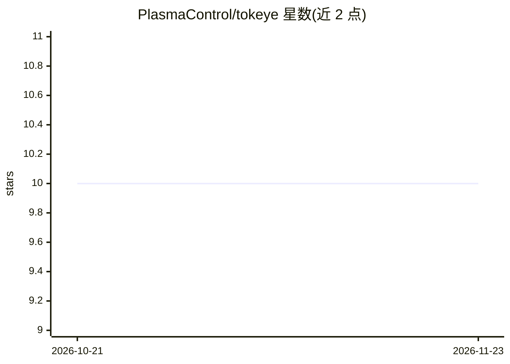

# PlasmaControl/tokeye

⭐ 10 · Python · MIT · 推送 2026-11-07 · [GitHub](https://github.com/PlasmaControl/tokeye) · [官网](https://plasmacontrol.github.io/tokeye/) · 组织维护

**面向等离子体物理的波动信号自动分类与定位 Python 工具**

基于 Python 的开源应用：对时序信号或频谱图运行分割模型，输出逐像素掩码（相干/瞬态通道）、叠加预览图与参数 JSON；支持 .npy/.wav/.h5 等多种输入格式与 glob 批处理。附带 ELM 事件检测、Alfvén 模态实例检测等子命令，以及 Gradio 网页界面（分析/标注/工具三个标签页）。默认模型约 30 MB，首次使用从 Hugging Face 自动下载；CPU 即可运行，另支持 CUDA 与 MPS 设备。安装按 extras 拆分，训练部分需从源码克隆单独运行。

## 筛选速览

| 维度 | 判定 | 备注 |
|---|---|---|
| AI 角色 | `ai-native` | 本体是模型或模型工具 |
| 许可风险 | `permissive` | MIT |
| 部署形态 | `library` | 以包/库形式分发 |
| 模型依赖 | — | README 未给出锁定关系 |
| 硬件要求 | — | 无带数字的原话,不猜 |
| 安装摩擦 | `medium` | 含编译或系统依赖之一 |
| 成熟度 | — | 结构信号不足 |

## 能力要点

- 分割模型直接输出信号波动区域的掩码与预览图
- CLI 批处理支持 9 种输入格式与 glob 模式
- 内置 ELM 检测与 Alfvén 模态检测子命令
- Gradio 网页界面含分析、标注与音频格式转换

## 适用场景

- 对 DIII-D 磁探针等诊断数据做波动活动定位
- 批处理脚本中批量生成信号掩码与事件统计
- HPC 无外网计算节点上预取权重后离线推理
- 人工绘制掩码标注用于积累训练数据

## 场景标签

`科研工具` `目标检测` · 领域:学习与行业

## 证据(README 行号)

> L7: TokEye is an open-source Python-based application for automatic classification and localization of fluctuating signa
> L105: - **1D array** — a raw time series. TokEye computes its STFT spectrogram using the flags below before running infe
> L109: - `<stem>_mask.npy` — float32 sigmoid scores per pixel, shape `(C, H, W)`; `(2, H, W)` for the default model (chan

## 星数曲线

2026-10-21 10 → 2026-11-23 10（+0）

---
*卡片 v1 · prompt 1.4 · 生成 2026-11-20 · 置信度 high · 依据 README sha `6630e5a46093` · [字段定义](../../DATASET.md)*
