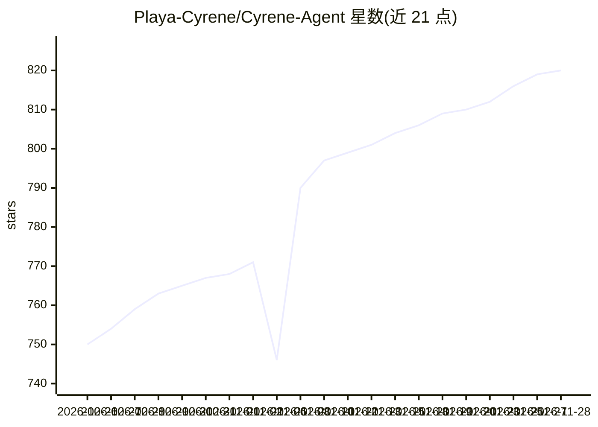

# Playa-Cyrene/Cyrene-Agent

⭐ 820 · TypeScript · MIT · 推送 2026-11-27 · [GitHub](https://github.com/Playa-Cyrene/Cyrene-Agent) · [官网](https://playaagentcyrene.online/) · 个人维护 · 中文 README

**面向个人用户的 Live2D 角色化桌面 AI 伴侣与助手**

以《崩坏：星穹铁道》昔涟为核心角色的 Windows 桌面 AI Agent，基于 Electron + TypeScript 与自研 CyreneHarness 引擎、DMAE 记忆引擎构建。提供 Chat/Work/Code/Learn 四种对话模式，整合 Live2D 桌面陪伴、分层个性化记忆、TTS/ASR 语音交互、工具调用（联网搜索、文件处理、浏览器操作、LSP 代码查询、MCP 扩展）以及飞书/微信/QQ 渠道接入。聊天依赖云端模型 API，可下载 Releases 打包版安装；源码构建需 Rust 与 VS Build Tools。角色 IP 与美术资产不属 MIT 授权，禁止商用。

## 筛选速览

| 维度 | 判定 | 备注 |
|---|---|---|
| AI 角色 | `ai-native` | 本体是模型或模型工具 |
| 许可风险 | `permissive` | MIT |
| 部署形态 | `desktop` | 安装包/桌面程序 |
| 模型依赖 | — | README 未给出锁定关系 |
| 硬件要求 | — | 无带数字的原话,不猜 |
| 安装摩擦 | `low` | 无编译、无系统依赖或容器化 |
| 成熟度 | — | 结构信号不足 |

## 能力要点

- Chat/Work/Code/Learn 四种对话模式，覆盖聊天、任务、代码与学习场景
- L0/L1/L2 分层记忆与自研 DMAE Worldbook 长期记忆管理
- 多 TTS/ASR 引擎语音交互与 VAD 静默检测
- 插件系统（npm SDK）、MCP 扩展与飞书/微信/QQ 多渠道接入

## 适用场景

- 桌面上养一个 Live2D 角色日常陪聊和主动交流
- 让 AI 助手串联工具完成搜索、文档生成、浏览器操作等任务
- 在绑定目录内让 AI 协助读写代码、查询 LSP 语义
- 绑定 Obsidian Vault 让 AI 陪伴整理笔记与练习

## 场景标签

`AI 助手` `聊天机器人` · 领域:对话与助手

## 证据(README 行号)

> L10: **Cyrene-Agent 是一个以《崩坏：星穹铁道》昔涟为核心角色的 Windows Live2D AI 桌面伴侣。**
> L12: > 基于 Electron + TypeScript 开发的桌面端 Live2D 智能对话 Agent。
> L15: > 支持日常聊天（Chat）、辅助工作（Work）、代码协作（Code）、学习陪伴（Learn）四种对话模式。

## 星数曲线

2026-10-26 750 → 2026-11-28 820（+70）

---
*卡片 v1 · prompt 1.4 · 生成 2026-11-24 · 置信度 high · 依据 README sha `477e8a79fcab` · [字段定义](../../DATASET.md)*
