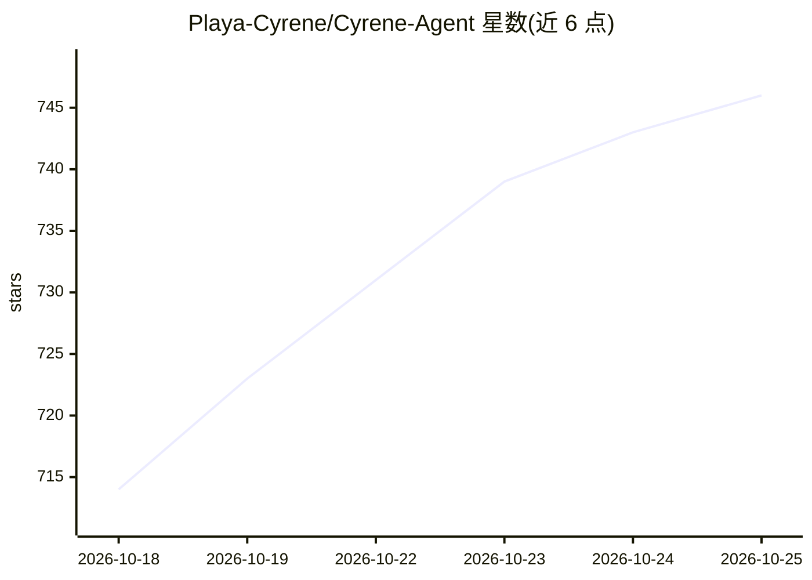

# Playa-Cyrene/Cyrene-Agent

⭐ 750 · TypeScript · MIT · 推送 2026-10-25 · [GitHub](https://github.com/Playa-Cyrene/Cyrene-Agent) · [官网](https://playaagentcyrene.online/) · 组织维护 · 中文 README

**以《崩坏：星穹铁道》昔涟为角色的 Windows Live2D AI 桌面伴侣**

基于 Electron + TypeScript 的桌面端 Live2D 智能对话 Agent，围绕昔涟角色设定，整合自研 CyreneHarness 引擎与 DMAE 记忆引擎，提供日常聊天、辅助工作（工具调用与内嵌浏览器控制）、代码协作（LSP 语义查询与受权限管控的命令执行）、学习陪伴（绑定 Obsidian Vault）四种模式，并支持 TTS/ASR 语音通话、MCP 扩展、插件系统与飞书/微信/QQ 渠道接入。仅支持 Windows 10/11 64 位；源码 MIT，但角色 IP、Live2D 模型与美术资产不在 MIT 范围内且禁止商业使用。

## 筛选速览

| 维度 | 判定 | 备注 |
|---|---|---|
| AI 角色 | `ai-native` | 本体是模型或模型工具 |
| 许可风险 | `permissive` | MIT |
| 部署形态 | `desktop` | 安装包/桌面程序 |
| 模型依赖 | — | README 未给出锁定关系 |
| 硬件要求 | — | 无带数字的原话,不猜 |
| 安装摩擦 | `low` | 无编译、无系统依赖或容器化 |
| 成熟度 | — | 结构信号不足 |

## 能力要点

- Live2D 角色桌面陪伴 + 四种对话模式（Chat/Work/Code/Learn）
- L0/L1/L2 分层记忆与 DMAE Worldbook 长期记忆管理
- Code 模式提供 13 种语言的 LSP 语义查询与权限审批沙箱
- 多渠道接入（飞书/微信 iLink/QQ）共享角色设定与记忆

## 适用场景

- 桌面常驻的 Live2D 角色陪聊与主动交流
- 让 agent 在绑定目录内协助读代码、查定义与执行受限命令
- 在 Obsidian Vault 中陪伴整理学习笔记与练习
- 通过飞书/微信/QQ 在手机端继续与同一角色对话

## 场景标签

`AI 助手` `Agent 记忆` `语音 Agent` · 领域:Agent 开发

## 证据(README 行号)

> L10: **Cyrene-Agent 是一个以《崩坏：星穹铁道》昔涟为核心角色的 Windows Live2D AI 桌面伴侣。**
> L14: > 将角色化聊天、个性化记忆、语音交互、工具调用与多平台接入整合在同一个桌面 Agent 中，
> L20: - **日常聊天（Chat）** — 专注角色化交流，结合会话历史、用户风格与长期记忆自然回应，不暴露任何工具

## 星数曲线

2026-10-18 714 → 2026-10-25 746（+32）

---
*卡片 v1 · prompt 1.4 · 生成 2026-10-21 · 置信度 high · 依据 README sha `54bf95c81027` · [字段定义](../../DATASET.md)*
