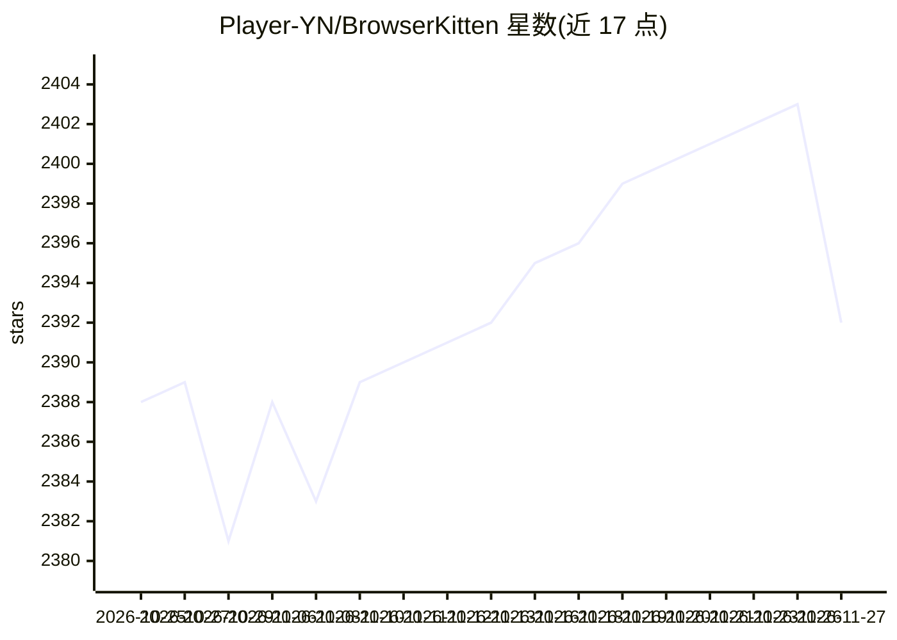

# Player-YN/BrowserKitten

⭐ 2,392 · JavaScript · MIT · 推送 2026-11-05 · [GitHub](https://github.com/Player-YN/BrowserKitten) · 个人维护 · 中文 README

**Chrome 侧边栏浏览器 Agent：读登录页、执行操作、本地跟进**

MIT 许可的 Chrome MV3 扩展，在侧边栏提供 agent，可读取用户已登录的页面内容、将点击/表单/导航委托给执行模型、在工作区保存文档与文件，并支持本地定时跟进任务。采用 BYOK（自带密钥）配置，推理与执行需分别配置模型端点；对话、工作区与任务数据保存在本机。安装无需构建步骤，加载源码目录即可；无云执行环境与 OS/终端控制。

## 筛选速览

| 维度 | 判定 | 备注 |
|---|---|---|
| AI 角色 | `ai-native` | 本体是模型或模型工具 |
| 许可风险 | `permissive` | MIT |
| 部署形态 | `desktop` | 安装包/桌面程序 |
| 模型依赖 | — | README 未给出锁定关系 |
| 硬件要求 | — | 无带数字的原话,不猜 |
| 安装摩擦 | `low` | 无编译、无系统依赖或容器化 |
| 成熟度 | — | 结构信号不足 |

## 能力要点

- 读取已登录页面并委托点击、表单、导航给单独配置的执行模型
- 会话工作区生成文档、HTML、数据等交付物
- 本地定时跟进任务（分钟级调度，任务抽屉管理）
- OpenAI 兼容 /chat/completions 端点的 BYOK 配置，无需订阅

## 适用场景

- 在已登录的网页上让 agent 收集信息并汇总成文档
- 让 agent 代为执行页面点击与表单填写
- 设置本地定时检查任务并接收变更报告

## 场景标签

`浏览器自动化` `AI 助手` · 领域:效率与自动化

## 证据(README 行号)

> L16: Browser Kitten is an MIT-licensed Chrome MV3 extension with an agent in the side panel. It works with your existing
> L50: Open **Settings** from the side-panel menu. For a bring-your-own-key setup:
> L58: Inference and System1 can use the same provider, but must be configured separately. The unpacked build accepts your

## 星数曲线

2026-10-25 2,388 → 2026-11-27 2,392（+4）

---
*卡片 v1 · prompt 1.4 · 生成 2026-11-23 · 置信度 high · 依据 README sha `1b376431fc57` · [字段定义](../../DATASET.md)*
