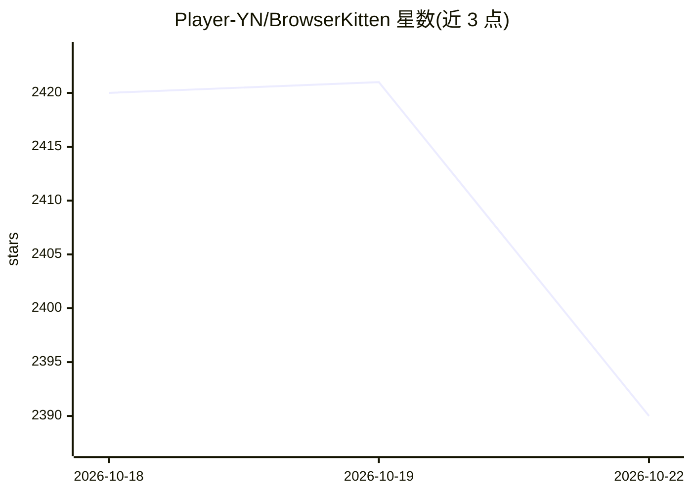

# Player-YN/BrowserKitten

⭐ 2,390 · JavaScript · MIT · 推送 2026-09-18 · [GitHub](https://github.com/Player-YN/BrowserKitten) · 个人维护 · 中文 README

**Chrome 侧边栏 Web Agent 扩展：选区描述任务，带走可编辑文档**

Chrome MV3 unpacked 扩展（爪爪·完全解放版），在侧边栏运行 agent，可驱动当前标签页、在浏览器内执行 guest JS，并在会话中保留表格/Univer 文档/站点 HTML 等产物。BYOK 模式：粘贴 OpenAI 兼容 API key（存于 chrome.storage.local），无托管模型、无服务器。不在 Chrome Web Store 上架，需开发者模式手动加载，无 package.json 与构建步骤，要求 Chrome 135+。

## 筛选速览

| 维度 | 判定 | 备注 |
|---|---|---|
| AI 角色 | `ai-native` | 本体是模型或模型工具 |
| 许可风险 | `permissive` | MIT |
| 部署形态 | `None` |  |
| 模型依赖 | — | README 未给出锁定关系 |
| 硬件要求 | — | 无带数字的原话,不猜 |
| 安装摩擦 | `low` | 无编译、无系统依赖或容器化 |
| 成熟度 | — | 结构信号不足 |

## 能力要点

- Chrome MV3 unpacked 扩展，侧边栏 agent 驱动当前标签页
- BYOK：OpenAI 兼容 API key，无托管模型、无服务器
- 会话内保留表格 / Univer 文档 / 站点 HTML 产物
- 提供 Node 回归测试与 Playwright 浏览器冒烟测试

## 适用场景

- 在已登录的网页上让 agent 代为完成操作并产出文档
- 把网页内容整理成可编辑的表格或文档
- 本地自带 API key 使用浏览器自动化 agent

## 场景标签

`浏览器自动化` · 领域:效率与自动化

## 证据(README 行号)

> L7: Treat the already-logged-in Chrome as a programmable computer. 爪爪 is the agent on that machine.
> L9: **爪爪 · 完全解放版** (`PawWork_ZhuaZhua`) is a Chrome MV3 **unpacked** extension. It runs a side-panel agent that can driv
> L17: 3. Open the side panel → paste an OpenAI-compatible API key (BYOK; stored in `chrome.storage.local`) → send a task 

## 星数曲线

2026-10-18 2,420 → 2026-10-22 2,390（-30）

---
*卡片 v1 · prompt 1.4 · 生成 2026-10-21 · 置信度 high · 依据 README sha `12041d6970b4` · [字段定义](../../DATASET.md)*
