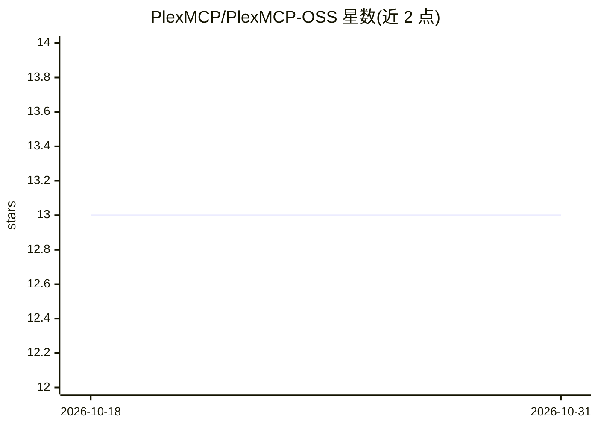

# PlexMCP/PlexMCP-OSS

⭐ 13 · Rust · NOASSERTION · 推送 2026-01-09 · [GitHub](https://github.com/PlexMCP/PlexMCP-OSS) · [官网](https://plexmcp.com) · 组织维护

**MCP 服务器网关平台：统一管理、编排与安全接入**

PlexMCP 是面向 AI 应用的 MCP（Model Context Protocol）服务器统一网关，提供 MCP 服务器编排（连接池与路由）、多租户组织与数据隔离、带作用域权限与限流的 API Key 管理、TOTP 两步验证、用量分析与审计日志。后端为 Rust/Axum，前端 Next.js 15，依赖 PostgreSQL 15+ 与 Redis 7+；支持 Docker 自托管，另有托管版 PlexMCP Cloud（含免费层与按量计费）。

## 筛选速览

| 维度 | 判定 | 备注 |
|---|---|---|
| AI 角色 | `ai-ecosystem` | LLM/agent 周边工具 |
| 许可风险 | `none` | NOASSERTION |
| 部署形态 | `library` | 以包/库形式分发 |
| 模型依赖 | — | README 未给出锁定关系 |
| 硬件要求 | — | 无带数字的原话,不猜 |
| 安装摩擦 | `low` | 无编译、无系统依赖或容器化 |
| 成熟度 | — | 结构信号不足 |

## 能力要点

- MCP 服务器编排：连接池与路由
- 多租户组织与数据隔离
- API Key 作用域权限与限流、TOTP 两步验证
- 用量分析与审计日志

## 适用场景

- 企业统一托管与代理多个 MCP 服务器接入
- 多团队隔离共享 MCP 资源并审计调用
- 自托管部署 MCP 网关并自管密钥与限流

## 场景标签

`模型网关` · 领域:Agent 开发

## 证据(README 行号)

> L16: PlexMCP is a unified gateway for managing and orchestrating MCP (Model Context Protocol) servers. It provides enter
> L18: - **MCP Server Orchestration** with connection pooling and routing (Docs)

## 星数曲线

2026-10-18 13 → 2026-10-31 13（+0）

---
*卡片 v1 · prompt 1.4 · 生成 2026-10-31 · 置信度 high · 依据 README sha `b48c38e87779` · [字段定义](../../DATASET.md)*
