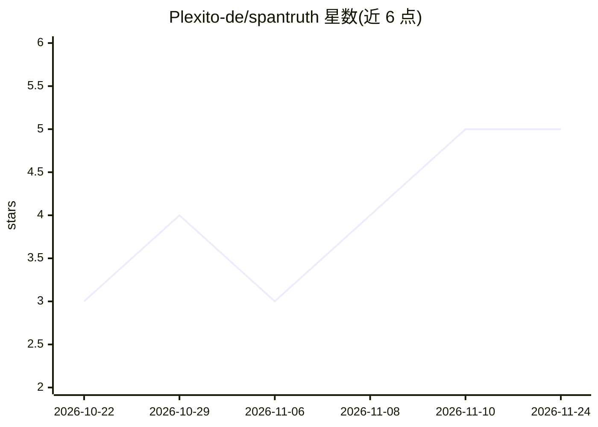

# Plexito-de/spantruth

⭐ 5 · Python · Apache-2.0 · 推送 2026-11-23 · [GitHub](https://github.com/Plexito-de/spantruth) · [官网](https://plexito-de.github.io/spantruth/) · 个人维护

**校验 LLM 埋点遥测是否与 provider 实际响应一致的测试工具**

通过伪造 provider 端点回放 45 种场景（流式、429、断连、缓存命中、提前关闭等），将 OpenTelemetry 埋点库上报的 token 数、缓存计数、finish reason、span 结束状态与真实线路数据比对，输出 pass/missing/wrong/lost/broken 判定矩阵。离线确定性运行，无需 API key；doctor 子命令读取项目锁文件在用户版本上运行，支持 --with 注入 PR 分支、--expect 基线文件在 CI 中拦截回归。被测对象为 OpenLLMetry、OpenInference 等埋点库。

## 筛选速览

| 维度 | 判定 | 备注 |
|---|---|---|
| AI 角色 | `ai-ecosystem` | LLM/agent 周边工具 |
| 许可风险 | `permissive` | Apache-2.0 |
| 部署形态 | `None` |  |
| 模型依赖 | — | README 未给出锁定关系 |
| 硬件要求 | — | 无带数字的原话,不猜 |
| 安装摩擦 | `low` | 无编译、无系统依赖或容器化 |
| 成熟度 | — | 结构信号不足 |

## 能力要点

- 45 种场景回放：流式、429、断连、提前关闭、缓存命中、并行工具调用
- 六种判定：pass/missing/wrong/lost/broken/inconclusive
- doctor 读取 uv.lock/poetry.lock 等锁文件，按用户版本运行
- --expect 基线对比与 GitHub Actions 集成，失败即拦截 PR

## 适用场景

- 在 CI 中防止埋点库升级引入新的遥测回归
- 给自研 instrumentation wrapper 做一致性验收
- 排查成本仪表盘 token 计数与账单不符的根因
- 为上游埋点库 bug 报告生成可复现链接

## 场景标签

`LLM 可观测性` · 领域:评测与运维

## 证据(README 行号)

> L3: **Does your LLM telemetry tell the truth?** spantruth replays provider responses through LLM
> L34: Cost dashboards, token budgets, alerts and audits all read the numbers that instrumentation
> L116: You need uv. No clone, no API keys:

## 星数曲线

2026-10-22 3 → 2026-11-24 5（+2）

---
*卡片 v1 · prompt 1.4 · 生成 2026-11-21 · 置信度 high · 依据 README sha `768f34ff4e3b` · [字段定义](../../DATASET.md)*
