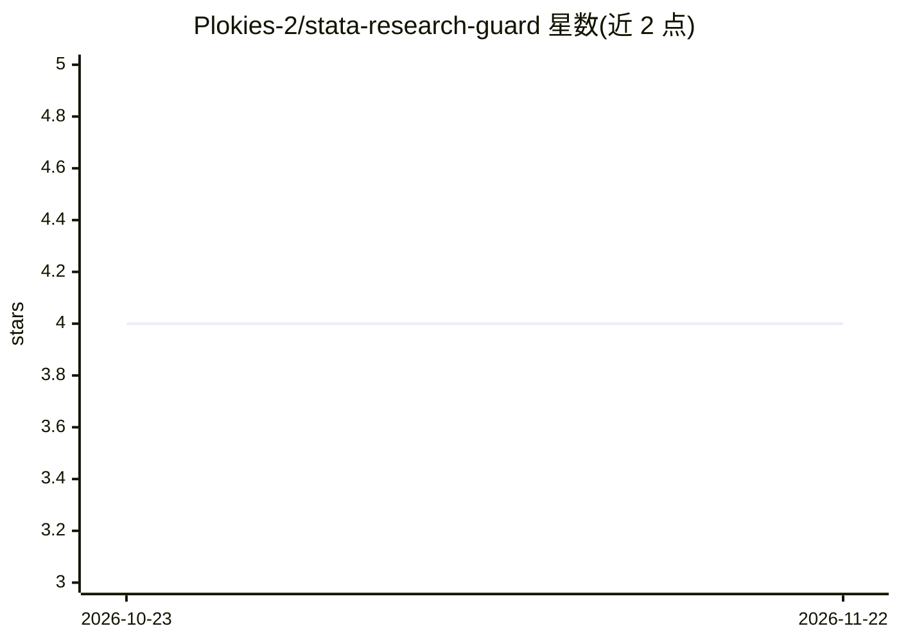

# Plokies-2/stata-research-guard

⭐ 4 · Stata · MIT · 推送 2026-11-21 · [GitHub](https://github.com/Plokies-2/stata-research-guard) · 个人维护

**为经济学研究者的 AI 辅助 Stata 编码提供指导与工具的 Codex 插件**

以 Codex 插件形式安装，为 AI 辅助 Stata 研究提供指导资源与工作流技能：内含 115 条命令索引、118 个官方/维护者帮助主题、69 篇 Stata 18 PDF 文档条目、166 段真实论文代码块和 12 份原始运行日志，通过 MCP 工具（如 get_stata_command_evidence）供模型检索。提供 stata-replication-workflow 与 stata-peer-audit 两个技能，覆盖从原始数据到论文表格图表的复现流程与只读代码评审。运行分析与查询已安装帮助需用户自备 Stata，已在 Windows 验证，macOS 兼容尚未实现。

## 筛选速览

| 维度 | 判定 | 备注 |
|---|---|---|
| AI 角色 | `ai-native` | 本体是模型或模型工具 |
| 许可风险 | `permissive` | MIT |
| 部署形态 | `None` |  |
| 模型依赖 | — | README 未给出锁定关系 |
| 硬件要求 | — | 无带数字的原话,不猜 |
| 安装摩擦 | `low` | 无编译、无系统依赖或容器化 |
| 成熟度 | — | 结构信号不足 |

## 能力要点

- 提供 115 条命令索引、118 个帮助主题、166 段论文代码块等研究证据资源
- stata-replication-workflow 技能：从原始数据追踪到表格与图表的可复现流程
- stata-peer-audit 技能：以只读方式对已有分析代码做同行评审
- 通过 MCP 连接 Stata 执行，支持 batch mode 或 Python 集成路由

## 适用场景

- 复现论文 replication package 中的核心回归结果
- 让 AI 阅读现有 .do 文件并给出维护性评审意见
- 估计完成后导出表格失败时，从已保存的 .ster 恢复输出

## 场景标签

`数据分析` `代码审查` `工作流自动化` · 领域:效率与自动化

## 证据(README 行号)

> L19: Stata Research Guard provides research guidance for AI-assisted Stata: readable analysis code, original command hel
> L47: **Tools needed:** Codex and Node.js. Running the analysis and looking up installed help use your own Stata installa
> L79: |**Peer review**|When requested or useful for a concrete research question, a colleague in a separate context reads

## 星数曲线

2026-10-23 4 → 2026-11-22 4（+0）

---
*卡片 v1 · prompt 1.4 · 生成 2026-11-21 · 置信度 mid · 依据 README sha `9ac353dd336f` · [字段定义](../../DATASET.md)*
