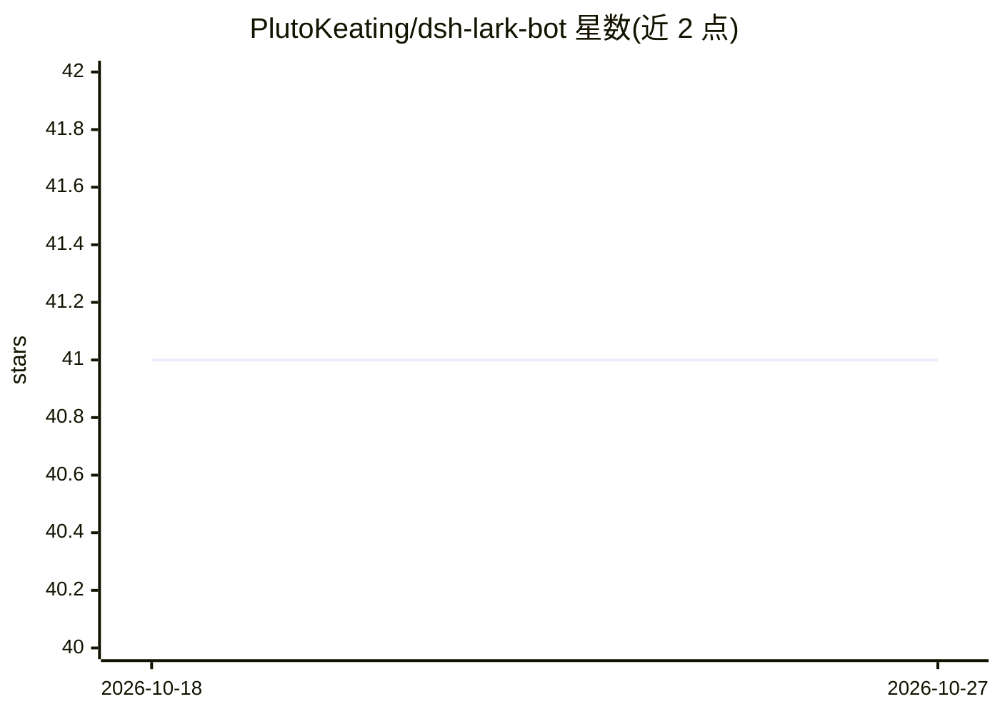

# PlutoKeating/dsh-lark-bot

⭐ 41 · TypeScript · AGPL-3.0 · 推送 2026-08-25 · [GitHub](https://github.com/PlutoKeating/dsh-lark-bot) · [官网](https://dsh-lark-bot.plutokeating.beer) · 个人维护 · 中文 README

**把 DeepSeek Harness 本机 coding agent 接入飞书/Lark 的桥接插件**

面向使用 DeepSeek Harness（dsh）的开发者的飞书/Lark 桥接插件：走飞书 WebSocket 出站长连接，无需公网 IP 或内网穿透，扫码 30 秒绑定后可在手机私聊/群聊/话题中指挥本机 coding agent。功能包括流式卡片、每会话隔离 git worktree 工作区、并行多任务、多角色 Agent、对话内模型/密钥管理、跨会话通知、`/upgrade` 飞书内自更新，以及 dsh 崩溃后仍可回复与自愈的安全网守护。以 npx 一键安装进 dsh profile，需 Node.js ≥ 22.19 与已配置密钥的 dsh；AGPL-3.0，商用需另行授权。

## 筛选速览

| 维度 | 判定 | 备注 |
|---|---|---|
| AI 角色 | `ai-ecosystem` | LLM/agent 周边工具 |
| 许可风险 | `viral` | AGPL-3.0 |
| 部署形态 | `desktop` | 安装包/桌面程序 |
| 模型依赖 | locked-api |  |
| 硬件要求 | — | 无带数字的原话,不猜 |
| 安装摩擦 | `low` | 无编译、无系统依赖或容器化 |
| 成熟度 | — | 结构信号不足 |

## 能力要点

- 飞书 WebSocket 出站长连接，无需公网 IP/域名/内网穿透
- dsh 崩溃后飞书仍可回复，`/safemode` 自愈并自动恢复排队任务
- 每会话自动创建隔离 git worktree 项目工作区
- 多角色 Agent（`/role`）与对话内模型/密钥管理卡片

## 适用场景

- 在手机飞书里远程指挥本机 coding agent 执行任务
- 同一群聊并行跑多个任务并保持会话隔离
- 任务完成后跨会话推送到其他群并 @ 相关人

## 场景标签

`编码 Agent` · 领域:编码与开发

## 证据(README 行号)

> L19: 让 DeepSeek Harness 成为你飞书里的一员，在手机、群聊、话题里直接指挥本机 coding agent。
> L104: - **DeepSeek Harness（`dsh`）**：已验证 **0.1.0-rc.8**（2026-08-25），经官方 `@deepseek-ai/dsh-sdk-client` / `dsh-acp` 接入；锁定版本

## 星数曲线

2026-10-18 41 → 2026-10-27 41（+0）

---
*卡片 v1 · prompt 1.4 · 生成 2026-10-25 · 置信度 high · 依据 README sha `8b27944e2127` · [字段定义](../../DATASET.md)*
