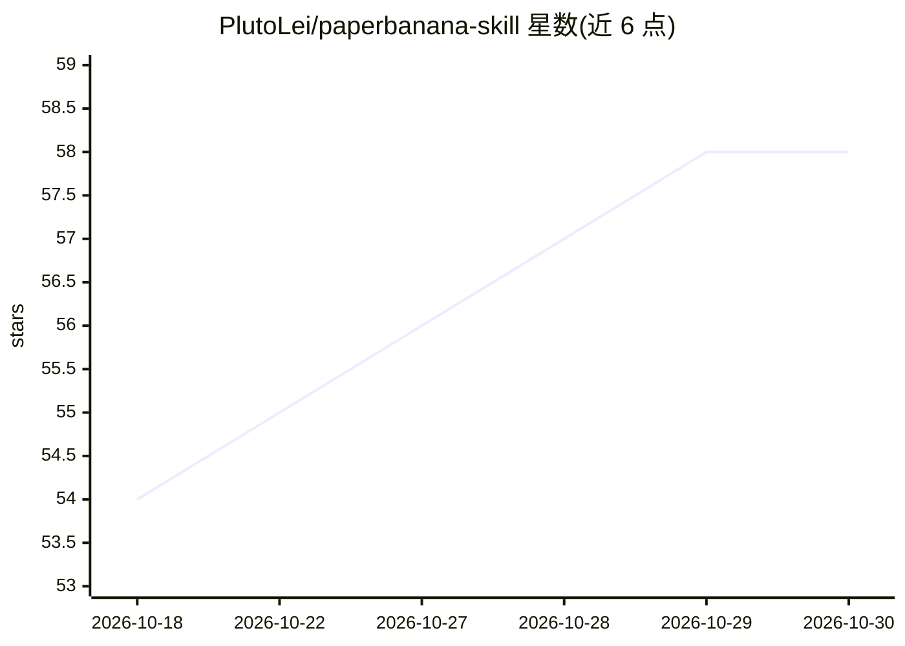

# PlutoLei/paperbanana-skill

⭐ 58 · TypeScript · MIT · 推送 2026-10-03 · [GitHub](https://github.com/PlutoLei/paperbanana-skill) · [官网](https://github.com/PlutoLei/paperbanana-skill#quick-start) · 个人维护 · 中文 README

**给科研者的 agent 技能集：生成学术图表与可编辑 PPT**

面向 Claude Code 与 Codex 的 agent 技能包（含 paperbanana 与 paperbanana-slide-deck），通过 Python 后端流水线完成学术图的检索、规划、样式、生成与 Critic 自动评审，并支持生成可编辑的原生 PowerPoint 对象（本地渲染需 Bun，无需图像 API）。图像生成可接入 Gemini/Vertex、OpenAI 等图像/VLM 提供方。限制：生成输出可能含文字或图表错误，Critic 分数非学术认可，发布前需人工复核。

## 筛选速览

| 维度 | 判定 | 备注 |
|---|---|---|
| AI 角色 | `ai-ecosystem` | LLM/agent 周边工具 |
| 许可风险 | `permissive` | MIT |
| 部署形态 | `library` | 以包/库形式分发 |
| 模型依赖 | locked-api |  |
| 硬件要求 | — | 无带数字的原话,不猜 |
| 安装摩擦 | `low` | 无编译、无系统依赖或容器化 |
| 成熟度 | `idea` | |

## 能力要点

- 从方法描述生成学术图表与图像式幻灯片
- 生成可编辑的原生 PowerPoint 对象（本地渲染需 Bun，无图像 API 调用）
- 流水线含规划、样式、生成与 Critic 自动评审
- 支持 Claude Code 插件市场与 Codex 技能安装器两种安装途径

## 适用场景

- 把方法描述转成论文用的架构图/流程图
- 规划视觉风格一致的多页学术幻灯片
- 生成可在 PowerPoint 中继续编辑的原生幻灯片

## 场景标签

`图像生成` `科研工具` · 领域:内容生成

## 证据(README 行号)

> L13: Turn a methods description into a figure, plan a consistent slide deck, or build PowerPoint objects you can edit. U
> L68: - **`paperbanana`** guides figure, plot and slide requests through the configured Python pipeline: retrieval, plann
> L70: - **Python backend** supplies model integrations and the generation/review pipeline. The local editable renderer li

## 星数曲线

2026-10-18 54 → 2026-10-30 58（+4）

---
*卡片 v1 · prompt 1.4 · 生成 2026-10-24 · 置信度 high · 依据 README sha `381b7e8cc6d4` · [字段定义](../../DATASET.md)*
