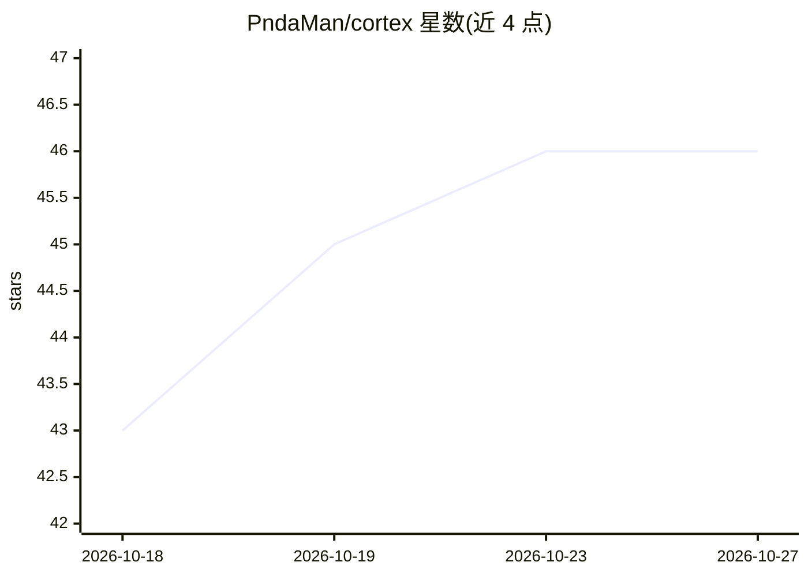

# PndaMan/cortex

⭐ 46 · Svelte · Apache-2.0 · 推送 2026-10-26 · [GitHub](https://github.com/PndaMan/cortex) · [官网](https://cortexos.study) · 个人维护

**本地优先的桌面学习系统：把课件资料变成备考材料与引用溯源对话**

基于 Tauri（Svelte 5 + Rust）的桌面学习应用，自述为开源 NotebookLM 替代品。将 PDF、PPTX、网页、YouTube、录音等来源汇入 Subjects→Topics→Sources 结构，经解析→分块→嵌入存入本地 SQLite，生成备考清单、FSRS 间隔重复闪卡、测验/限时模拟考、双主持音频概览、信息图与思维导图，并提供带行内引用的对话。AI 采用自带 API key 模式（Gemini/OpenRouter/OpenAI/Claude/Ollama），转录依赖 Whisper 系模型（本地 faster-whisper/whisper.cpp、Groq/OpenAI 云端或自建 WhisperX）。提供 macOS/Windows/Linux 安装包，也可从源码构建。

## 筛选速览

| 维度 | 判定 | 备注 |
|---|---|---|
| AI 角色 | `ai-native` | 本体是模型或模型工具 |
| 许可风险 | `permissive` | Apache-2.0 |
| 部署形态 | `desktop` | 安装包/桌面程序 |
| 模型依赖 | local-ok | 支持本地模型 |
| 硬件要求 | — | 无带数字的原话,不猜 |
| 安装摩擦 | `low` | 无编译、无系统依赖或容器化 |
| 成熟度 | — | 结构信号不足 |

## 能力要点

- 摄入 PDF/PPTX/DOCX/网页/YouTube/录音/图片，本地 SQLite 存储
- FSRS 间隔重复闪卡、限时模拟考、测验、音频概览、信息图、思维导图生成
- 带行内引用的对话，混合检索（sqlite-vec 向量 + 关键词）
- BYOK 多供应商接入（Gemini/OpenRouter/OpenAI/Claude/Ollama），Anki 导入导出与加密备份

## 适用场景

- 把整门课程的课件和讲义整理成闪卡与备考清单
- 针对自己的资料提问并获得带来源引用的回答
- 用间隔重复和时间表追踪复习进度与考试截止日期

## 场景标签

`文档问答` · 领域:知识与检索

## 证据(README 行号)

> L7: Ingest everything a course throws at you — slides, PDFs, docs, lecture recordings, web pages, YouTube — into a clean
> L45: NotebookLM is great, but it's a web product: your sources live on someone else's servers, you can't pick your model

## 星数曲线

2026-10-18 43 → 2026-10-27 46（+3）

---
*卡片 v1 · prompt 1.4 · 生成 2026-10-25 · 置信度 mid · 依据 README sha `1c305ae364cb` · [字段定义](../../DATASET.md)*
