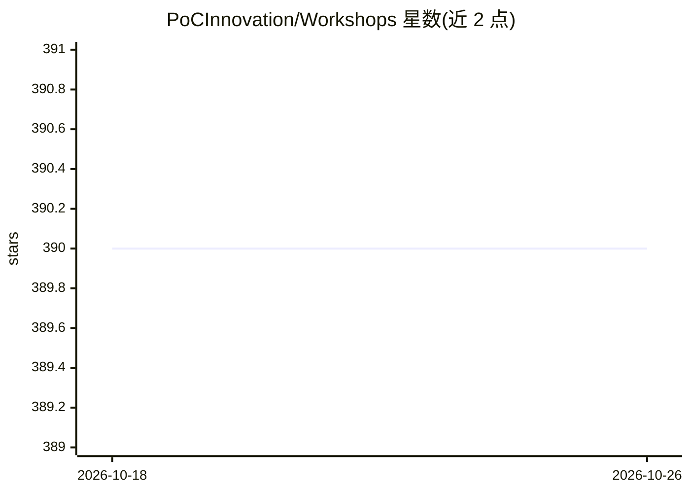

# PoCInnovation/Workshops

⭐ 390 · Jupyter Notebook · MIT · 推送 2025-12-18 · [GitHub](https://github.com/PoCInnovation/Workshops) · [官网](http://poc-innovation.fr) · 组织维护

**面向开发者的技术研讨会主题与材料集合**

PoC Innovation 组织维护的研讨会（Workshop）主题与材料仓库，覆盖 AI、AR/VR、硬件、安全、软件、点对点等方向。README 仅列出主题分类与组织的社交媒体链接（LinkedIn、Instagram、Twitter、Discord、官网），未在可见范围内给出具体课程结构、安装步骤或运行方式，各主题材料位于仓库子目录中，详细内容需进一步查阅。面向参加研讨会的学生与开发者。

## 筛选速览

| 维度 | 判定 | 备注 |
|---|---|---|
| AI 角色 | `ai-knowledge` | 知识聚合/清单类 |
| 许可风险 | `permissive` | MIT |
| 部署形态 | `None` |  |
| 模型依赖 | — | README 未给出锁定关系 |
| 硬件要求 | — | 无带数字的原话,不猜 |
| 安装摩擦 | `low` | 无编译、无系统依赖或容器化 |
| 成熟度 | — | 结构信号不足 |

## 能力要点

- 覆盖 AI、AR/VR、安全、区块链、硬件等 6 类研讨主题（据描述含 12 个主题标签）
- 由 PoC Innovation 组织维护，附带社区入口（Discord/官网等）

## 适用场景

- 查找安全、AI、区块链等方向的动手研讨材料
- 跟随组织的学习路径入门新技术主题

## 场景标签

`教程课程` · 领域:学习与行业

## 证据(README 行号)

> L1: # Workshops &nbsp;PoC Logo
> L3: All workshop subjects and materials for developers. Made with ❤️.

## 星数曲线

2026-10-18 390 → 2026-10-26 390（+0）

---
*卡片 v1 · prompt 1.4 · 生成 2026-10-21 · 置信度 low · 依据 README sha `595fda868c42` · [字段定义](../../DATASET.md)*
