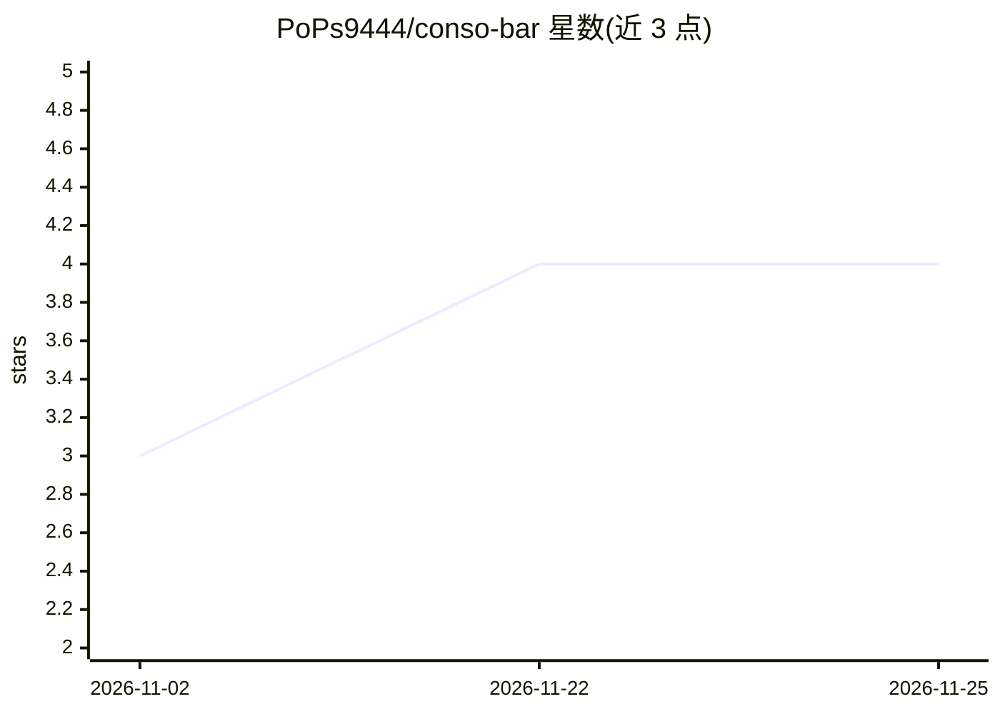

# PoPs9444/conso-bar

⭐ 4 · TypeScript · MIT · 推送 2026-11-22 · [GitHub](https://github.com/PoPs9444/conso-bar) · [官网](https://github.com/PoPs9444/conso-bar#readme) · 个人维护

**为 Claude Code 用户提供用量面板：限额、上下文、成本与运行中 agent**

以 Claude Code 插件形式安装的面板，在对话旁显示 5 小时与每周限额及预测、上下文窗口占用、当天与近 7 天成本、运行中 agent 的模型/工具/token/估算成本，并可一键触发 /compact 或结束 agent；另含按应用分列的 CPU/GPU/内存系统卡。限额数据经 Claude Code 签名的只读请求从 Anthropic 获取，全部计算与存储留在本机。需要支持 mods 的 Claude Code 版本；无 Pro/Max 订阅时面板显示会话成本而非限额。支持 6 种界面语言与卡片自定义布局。

## 筛选速览

| 维度 | 判定 | 备注 |
|---|---|---|
| AI 角色 | `ai-ecosystem` | LLM/agent 周边工具 |
| 许可风险 | `permissive` | MIT |
| 部署形态 | `None` |  |
| 模型依赖 | — | README 未给出锁定关系 |
| 硬件要求 | — | 无带数字的原话,不猜 |
| 安装摩擦 | `low` | 无编译、无系统依赖或容器化 |
| 成熟度 | — | 结构信号不足 |

## 能力要点

- 显示 5 小时/每周限额、重置时间与平均节奏预测
- 运行中 agent 的模型、当前工具、token 与估算成本展示，可一键 Stop
- System 卡按应用分列 CPU/GPU/内存，macOS/Linux/Windows 均支持
- 全部数据本机存储，仅发出版本检查与 /usage 两类只读请求

## 适用场景

- Claude Code 重度使用者想在触顶前掌握限额余量
- 同时跑多个 agent 时监控各自 token 与成本
- 多会话场景下追踪每天与每周的开销

## 场景标签

`LLM 可观测性` · 领域:评测与运维

## 证据(README 行号)

> L5: **The usage panel for Claude Code.**
> L11: Claude Code plugin
> L40: |**Limits at a glance**|Your 5-hour and weekly usage, the time until each resets, and a forecast at your average pa

## 星数曲线

2026-11-02 3 → 2026-11-25 4（+1）

---
*卡片 v1 · prompt 1.4 · 生成 2026-11-22 · 置信度 high · 依据 README sha `284e0c6502d5` · [字段定义](../../DATASET.md)*
