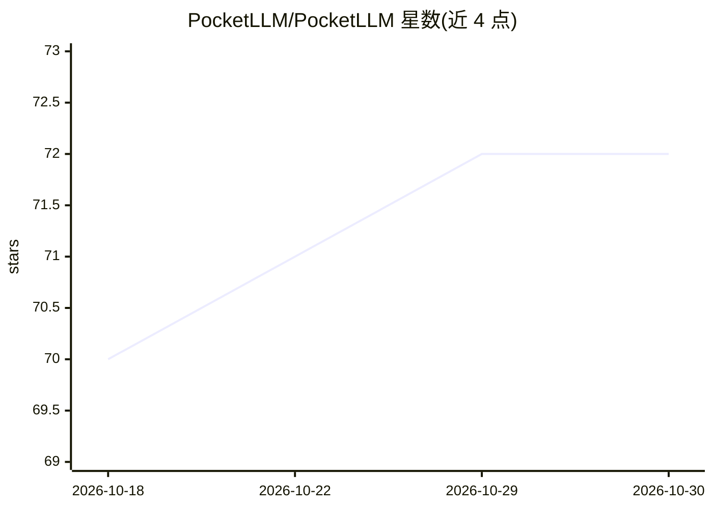

# PocketLLM/PocketLLM

⭐ 72 · Dart · 推送 2026-07-01 · [GitHub](https://github.com/PocketLLM/PocketLLM) · [官网](https://pocketllm-ai.vercel.app/) · 组织维护

**跨平台 LLM 聊天客户端：Flutter 应用加 FastAPI 后端**

由 Flutter 客户端与 FastAPI 后端组成的跨平台 AI 聊天应用：通过 OpenAI、Groq、OpenRouter、ImageRouter 官方 SDK 聚合模型目录（统一 /v1/models 端点），用户自带 API key 激活服务商，密钥经 Fernet 加密存储于 Supabase；支持流式聊天、Markdown 渲染、token 计量、模型收藏与默认设置，覆盖 Android/iOS/macOS/Windows/Linux/Web。限制：依赖 Supabase 实例与各服务商账号，注册为邀请码门控。

## 筛选速览

| 维度 | 判定 | 备注 |
|---|---|---|
| AI 角色 | `ai-native` | 本体是模型或模型工具 |
| 许可风险 | `none` | — |
| 部署形态 | `None` |  |
| 模型依赖 | locked-api |  |
| 硬件要求 | — | 无带数字的原话,不猜 |
| 安装摩擦 | `low` | 无编译、无系统依赖或容器化 |
| 成熟度 | — | 结构信号不足 |

## 能力要点

- 统一目录聚合 OpenAI/Groq/OpenRouter/ImageRouter（BYO API key，官方 SDK）
- 密钥 Fernet 加密存储，不回退环境变量凭据
- 流式响应、Markdown 渲染与 token 计量
- 同一 Flutter 界面覆盖六大平台

## 适用场景

- 在手机和桌面用同一界面访问多个 LLM 服务商
- 用自己的 API key 管理和切换多家模型目录
- 跨设备保持一致的聊天体验与历史记录

## 场景标签

`聊天机器人` · 领域:对话与助手

## 证据(README 行号)

> L3: PocketLLM is a cross-platform assistant that pairs a Flutter application with a FastAPI backend to deliver secure, l
> L19: 1. **Unified catalogue** – aggregate models from OpenAI, Groq, OpenRouter, and ImageRouter using official SDKs with
> L31: |**Chat experience**|Streaming responses, Markdown rendering, inline code blocks, and token accounting.|

## 星数曲线

2026-10-18 70 → 2026-10-30 72（+2）

---
*卡片 v1 · prompt 1.4 · 生成 2026-10-24 · 置信度 high · 依据 README sha `fed1dd03e8d9` · [字段定义](../../DATASET.md)*
