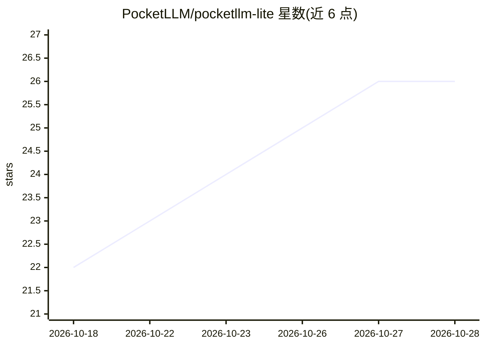

# PocketLLM/pocketllm-lite

⭐ 26 · Dart · MIT · 推送 2026-10-15 · [GitHub](https://github.com/PocketLLM/pocketllm-lite) · [官网](https://pocketllm-lite.vercel.app/) · 组织维护

**Android 本地优先 AI 聊天应用：设备端跑模型、带 RAG 与隐私审计**

面向终端用户的 Android 聊天应用（MIT，Flutter 实现）：通过 Cactus 运行时在设备端运行 Cactus 格式模型包；GGUF 不能本地加载，只能连接 Ollama 或 OpenAI 兼容服务端使用。功能包括流式聊天与历史、PDF/TXT/MD/CSV 文档导入及关键词/语义/混合检索、设备端 OCR 与 Whisper 语音转录、策略网关网络审计与严格离线模式、AES-256-GCM 加密备份。提供 arm64-v8a APK（仅该架构含设备端运行时），需 Android 7.0+；英文界面，翻译未接入。另有 Next.js 网页版（不含设备端运行时）。

## 筛选速览

| 维度 | 判定 | 备注 |
|---|---|---|
| AI 角色 | `ai-native` | 本体是模型或模型工具 |
| 许可风险 | `permissive` | MIT |
| 部署形态 | `None` |  |
| 模型依赖 | local-ok | 支持本地模型 |
| 硬件要求 | — | 无带数字的原话,不猜 |
| 安装摩擦 | `low` | 无编译、无系统依赖或容器化 |
| 成熟度 | `idea` | |

## 能力要点

- Cactus 运行时设备端模型推理，无账号无托管推理
- PDF/TXT/MD/CSV 导入与关键词/语义/混合检索（带来源引用）
- 统一策略网关、网络审计日志与严格离线模式（阻断非环回流量）
- 设备端 Whisper 转录与 ML Kit OCR

## 适用场景

- 在手机上离线与本地模型对话
- 导入自己的文档做带来源引用的问答
- 连接自建 Ollama/OpenAI 兼容服务端使用 GGUF 模型

## 场景标签

`聊天机器人` `RAG` `语音识别` `OCR` · 领域:对话与助手

## 证据(README 行号)

> L19: - **It actually runs on your phone.** Cactus-format model bundles (the in-app
> L20:  catalog downloads these) run on-device through the
> L80: 3. **Chat.** The selected model, not a canned reply, produces every response. If

## 星数曲线

2026-10-18 22 → 2026-10-28 26（+4）

---
*卡片 v1 · prompt 1.4 · 生成 2026-10-27 · 置信度 high · 依据 README sha `63b303c6fe97` · [字段定义](../../DATASET.md)*
