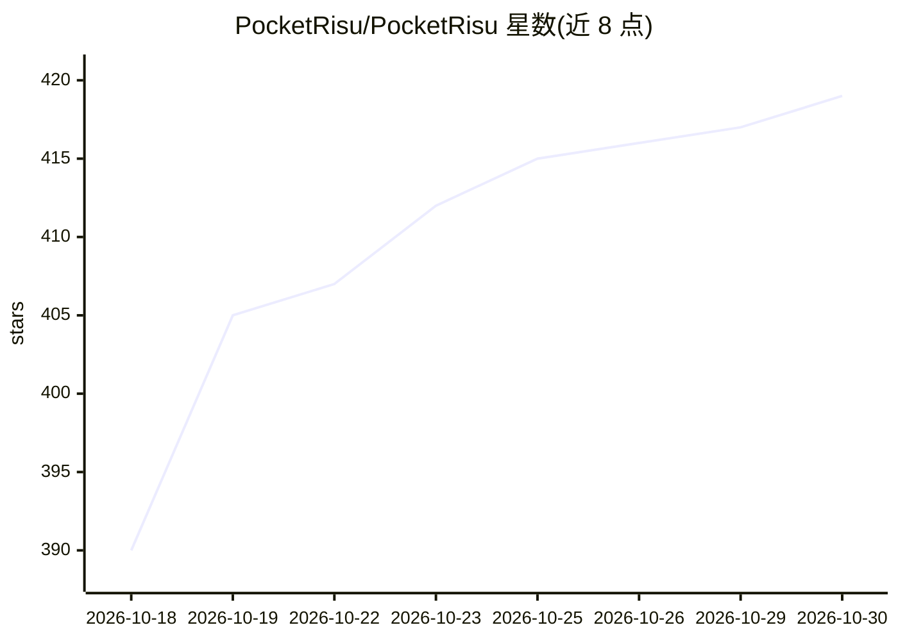

# PocketRisu/PocketRisu

⭐ 419 · TypeScript · GPL-3.0 · 推送 2026-10-25 · [GitHub](https://github.com/PocketRisu/PocketRisu) · [官网](https://pocketrisu.com/) · 组织维护 · 中文 README

**自托管 AI 角色扮演聊天平台，PC/手机浏览器访问**

从 RisuAI 衍生的自托管 AI 角色扮演聊天平台，运行在个人电脑或个人服务器上，通过浏览器从 PC、平板、手机访问。服务端生成使锁屏或断线后回复不丢失；所有数据（角色、聊天、设置、内嵌图像）存于服务器单一 SQLite 数据库，无外部云依赖。兼容 RisuAI 生态资产（RisuRealm 角色下载、.charx 等角色卡、模块/世界书/预设、.bin 备份双向兼容）。支持 OpenAI、Claude、Gemini、DeepInfra、OpenRouter、Ollama 等多供应方，提供 HypaMemoryV3 记忆、自动翻译、TTS、正则脚本与插件、自更新及 Tailscale/Quick Tunnel 远程访问。GPL-3.0 许可。

## 筛选速览

| 维度 | 判定 | 备注 |
|---|---|---|
| AI 角色 | `ai-native` | 本体是模型或模型工具 |
| 许可风险 | `viral` | GPL-3.0 |
| 部署形态 | `None` |  |
| 模型依赖 | local-ok | 支持本地模型 |
| 硬件要求 | — | 无带数字的原话,不猜 |
| 安装摩擦 | `low` | 无编译、无系统依赖或容器化 |
| 成熟度 | — | 结构信号不足 |

## 能力要点

- 服务端生成：锁屏/断线后重连自动恢复完整回复
- 全部数据存于单一 SQLite 数据库，无外部云依赖
- 多供应方接入：OpenAI、Claude、Gemini、DeepInfra、OpenRouter、Ollama 等
- RisuAI 数据整体迁移，生态资产原样可用（角色卡/模块/世界书/备份）

## 适用场景

- 在自家电脑或服务器上搭建 AI 角色扮演聊天服务
- 手机、平板、PC 多设备浏览器访问同一聊天数据
- 从 RisuAI 迁移既有角色、聊天记录与备份

## 场景标签

`聊天机器人` · 领域:对话与助手

## 证据(README 行号)

> L17: PocketRisu is a self-hosted AI roleplay chat platform you run on your PC or personal server and access from PC, tab
> L47: - **Multiple AI providers**: OpenAI, Claude, Gemini, DeepInfra, OpenRouter, Ollama, and more

## 星数曲线

2026-10-18 390 → 2026-10-30 419（+29）

---
*卡片 v1 · prompt 1.4 · 生成 2026-10-21 · 置信度 high · 依据 README sha `0183fe105d1b` · [字段定义](../../DATASET.md)*
