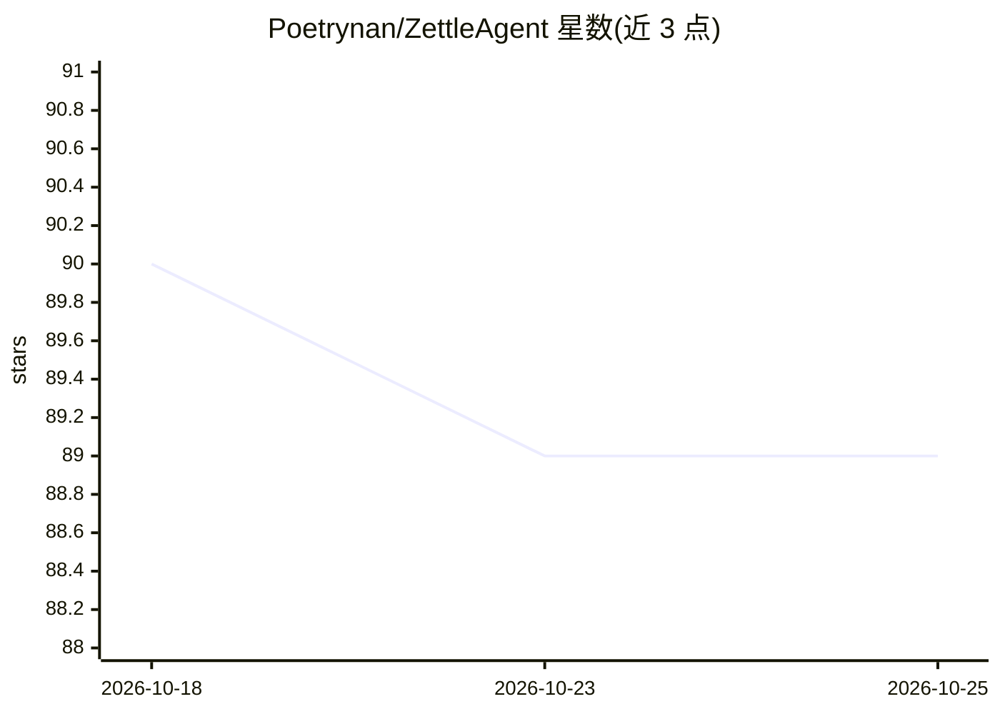

# Poetrynan/ZettleAgent

⭐ 89 · TypeScript · Apache-2.0 · 推送 2026-08-26 · [GitHub](https://github.com/Poetrynan/ZettleAgent) · [官网](https://poetrynan.github.io/zettelagent.org/) · 个人维护 · 中文 README

**本地优先的 Markdown 知识库桌面应用：自主 Agent 管理笔记与知识图谱**

基于 Tauri 2.0（React 19 + Rust）的桌面端知识管理应用：以纯 Markdown 文件夹为数据源，提供自主 Agent（6 类工具包、三层意图路由）、混合检索、SQLite-vec 本地向量库、PageRank/Louvain 图拓扑分析、无限画布与 FSRS-4.5 间隔重复。写入经 WriteGuard 人工审批并保存可逆补丁。安装包内置 nomic 嵌入引擎、ONNX Runtime WASM 与离线 OCR，开箱即用；可配置 DeepSeek/OpenAI/Claude/Gemini/Ollama 等 LLM。支持 Windows/macOS，Linux 为实验性。

## 筛选速览

| 维度 | 判定 | 备注 |
|---|---|---|
| AI 角色 | `ai-native` | 本体是模型或模型工具 |
| 许可风险 | `permissive` | Apache-2.0 |
| 部署形态 | `desktop` | 安装包/桌面程序 |
| 模型依赖 | local-ok | 支持本地模型 |
| 硬件要求 | — | 无带数字的原话,不猜 |
| 安装摩擦 | `low` | 无编译、无系统依赖或容器化 |
| 成熟度 | `idea` | |

## 能力要点

- 自主 Agent 含 6 类工具包与 L0/L1/L2 三层意图路由，本地 7B/14B 模型优化
- WriteGuard 写入门禁 + 100% 可逆 ChangeSet 补丁账本
- PageRank 中心性、Louvain 社区聚类与知识盲区诊断
- SQLite-vec + FTS5 纯本地向量与全文检索，零云遥测

## 适用场景

- 把本地 Markdown 文件夹当作第二大脑，由 Agent 检索、整理与审计笔记
- 在完全离线环境下使用带向量检索与知识图谱的笔记系统
- 通过画布进行 explain/compare/trace/cluster 四类空间推理
- 用内置 FSRS-4.5 引擎做间隔重复复习

## 场景标签

`知识库管理` `知识图谱` · 领域:知识与检索

## 证据(README 行号)

> L5:  ### Local-First, Agent-Native Knowledge Operating System
> L39: ### 🤖 Native Autonomous Agent (6 Domain Toolkits)
> L42: - **Local Small Model Optimization (7B/14B)**: Dynamically loads domain schemas to save 4,000+ Tokens per turn, eli

## 星数曲线

2026-10-18 90 → 2026-10-25 89（-1）

---
*卡片 v1 · prompt 1.4 · 生成 2026-10-23 · 置信度 high · 依据 README sha `3e391ae3309f` · [字段定义](../../DATASET.md)*
