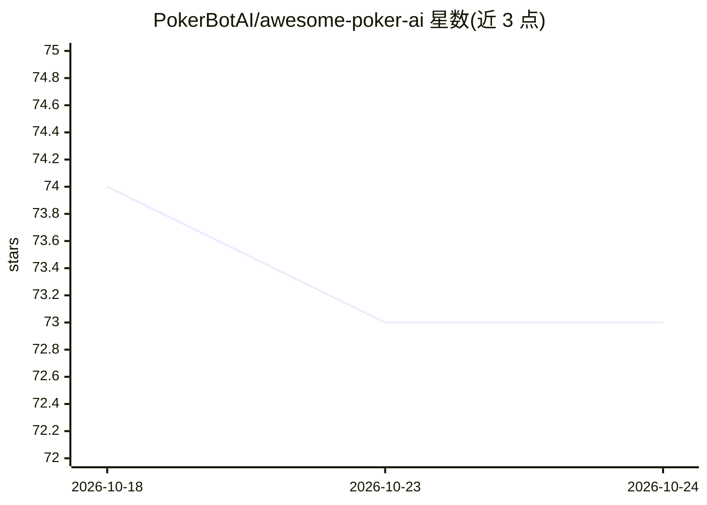

# PokerBotAI/awesome-poker-ai

⭐ 73 · 推送 2026-10-08 · [GitHub](https://github.com/PokerBotAI/awesome-poker-ai) · 组织维护

**AI 扑克资源策展清单：论文、开源工具、求解器与评测**

由 PokerBotAI 维护的策展清单，收录 AI 扑克研究论文（DeepStack、Libratus、Pluribus、ReBeL、PokerGPT、SpinGPT 等）、开源框架（OpenSpiel、RLCard、PokerRL 等）、手牌评估器、开源与商业 GTO 求解器、训练平台、AI 机器人、LLM 扑克项目及评测基准，并附 2025-2026 年 LLM 对扑克赛事与能力分析的记述。面向扑克 AI 研究者与开发者检索资源使用，许可为 CC0。

## 筛选速览

| 维度 | 判定 | 备注 |
|---|---|---|
| AI 角色 | `ai-knowledge` | 知识聚合/清单类 |
| 许可风险 | `none` | — |
| 部署形态 | `None` |  |
| 模型依赖 | — | README 未给出锁定关系 |
| 硬件要求 | — | 无带数字的原话,不猜 |
| 安装摩擦 | `low` | 无编译、无系统依赖或容器化 |
| 成熟度 | — | 结构信号不足 |

## 能力要点

- 收录里程碑论文（DeepStack/Libratus/Pluribus/ReBeL）及 2020 后研究
- 覆盖开源框架、手牌评估器、开源/商业求解器与训练平台的分类目录
- 收录 LLM 扑克项目与含模型战绩排行的评测基准（poker-eval）

## 适用场景

- 查找不完美信息博弈与扑克 AI 的研究论文脉络
- 对比选型开源扑克引擎、手牌评估器与 GTO 求解器
- 了解通用 LLM 在扑克任务上的表现与已知局限

## 场景标签

`精选清单` · 领域:学习与行业

## 证据(README 行号)

> L3: > A curated list of AI poker research, open-source tools, solvers, and educational resources. Updated for 2026.
> L9: ## Research Papers

## 星数曲线

2026-10-18 74 → 2026-10-24 73（-1）

---
*卡片 v1 · prompt 1.4 · 生成 2026-10-24 · 置信度 high · 依据 README sha `35c655e7e3c8` · [字段定义](../../DATASET.md)*
