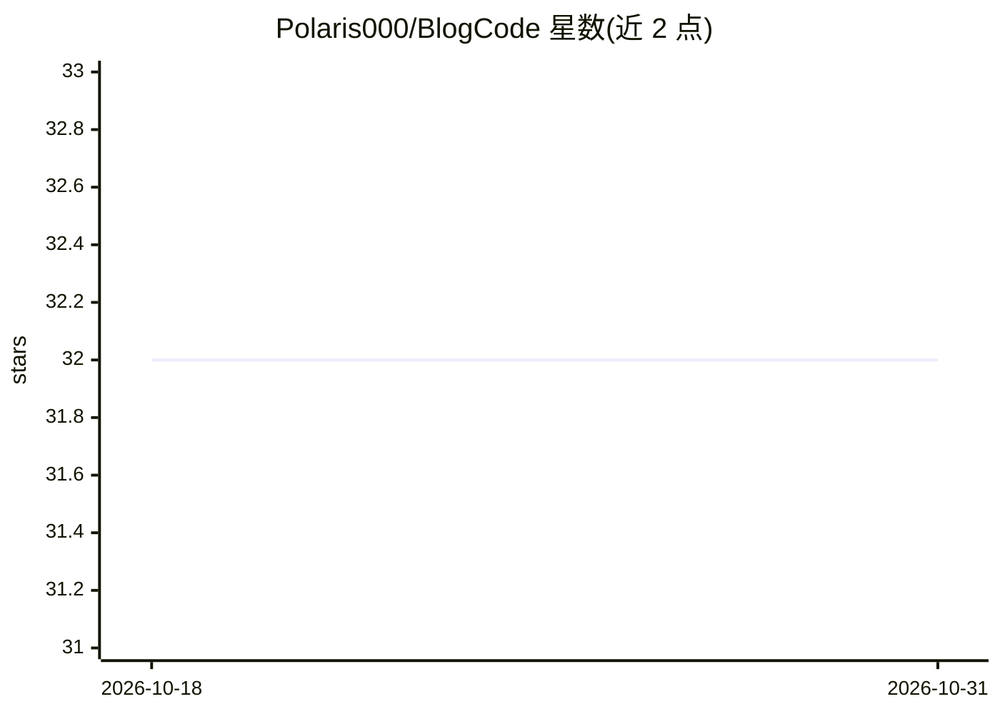

# Polaris000/BlogCode

⭐ 32 · Jupyter Notebook · MIT · 推送 2026-09-17 · [GitHub](https://github.com/Polaris000/BlogCode) · 个人维护

**博客文章配套代码示例集合：统计、机器学习与聊天机器人**

个人博客（Medium 及个人网站）文章的配套代码示例仓库，内容以表格形式按发布日期与主题索引，涵盖统计学（假设检验、最大似然、贝叶斯 Jacobian 调整）、算法（动态规划、生日悖论）、Python 技巧（NumPy 性能、装饰器）、多标签分类器评估，以及多篇基于 Rasa 的聊天机器人 NLU 示例。使用方式为 fork/clone 仓库后用 conda 创建 Python 3.8 环境，按需安装 requirements 文件中的依赖，每个项目目录内有各自的 README。

## 筛选速览

| 维度 | 判定 | 备注 |
|---|---|---|
| AI 角色 | `ai-knowledge` | 知识聚合/清单类 |
| 许可风险 | `permissive` | MIT |
| 部署形态 | `library` | 以包/库形式分发 |
| 模型依赖 | — | README 未给出锁定关系 |
| 硬件要求 | — | 无带数字的原话,不猜 |
| 安装摩擦 | `low` | 无编译、无系统依赖或容器化 |
| 成熟度 | — | 结构信号不足 |

## 能力要点

- 20+ 篇文章配套代码，覆盖统计、算法、Python 与聊天机器人
- 部分文章提供 Open In Colab 一键运行入口
- 依赖分为 Rasa 与 Python 数据科学两类，分别提供 requirements 文件

## 适用场景

- 跟着博客文章学习统计学与机器学习概念并运行代码
- 参考 Rasa 聊天机器人的搭建与失败处理示例
- 在 Colab 中直接运行部分文章的示例代码

## 场景标签

`教程课程` · 领域:学习与行业

## 证据(README 行号)

> L4: This is a repository of code samples from my blogposts. I'm writing on Medium at the moment. You can find me here.
> L7: |Link to the article|Code|Publish Date|Topics|

## 星数曲线

2026-10-18 32 → 2026-10-31 32（+0）

---
*卡片 v1 · prompt 1.4 · 生成 2026-10-26 · 置信度 high · 依据 README sha `f170c67f31ad` · [字段定义](../../DATASET.md)*
