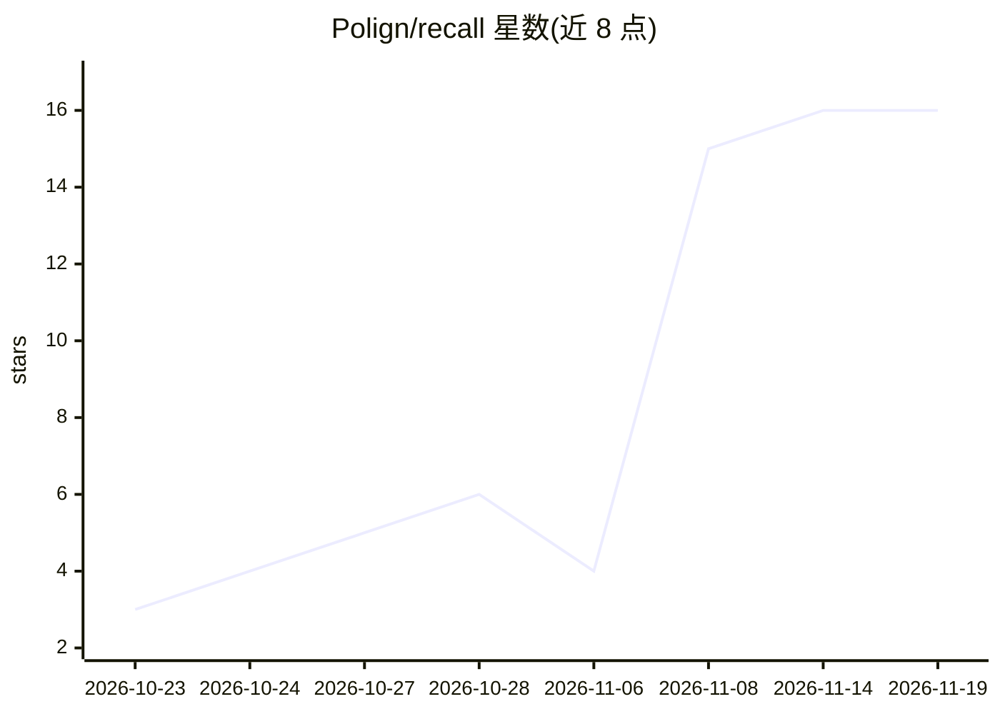

# Polign/recall

⭐ 16 · Go · Apache-2.0 · 推送 2026-11-18 · [GitHub](https://github.com/Polign/recall) · [官网](https://polign.com/recall) · 组织维护

**给 AI agent 的记忆与状态库：保留每次更正，可从自身记录恢复运行**

Recall 为 AI agent 提供跨会话、跨进程的记忆与状态：记忆以主语-谓词-类型值三元组存储，新值按谓词规则替换旧值且每次更正保留历史，支持 as_of/history/diff/explain 读取；状态部分记录工作状态、对话轮次、指针与工具调用，崩溃或迁移后经 lease 机制从记录恢复。形态为 Go 库、recall 二进制（MCP 工具与 HTTP 服务）及 Python 客户端，存储于用户自运行的数据库（本地/polign_db/PostgreSQL+pgvector/MongoDB/Qdrant）。State API 处于 beta。

## 筛选速览

| 维度 | 判定 | 备注 |
|---|---|---|
| AI 角色 | `ai-ecosystem` | LLM/agent 周边工具 |
| 许可风险 | `permissive` | Apache-2.0 |
| 部署形态 | `library` | 以包/库形式分发 |
| 模型依赖 | — | README 未给出锁定关系 |
| 硬件要求 | — | 无带数字的原话,不猜 |
| 安装摩擦 | `low` | 无编译、无系统依赖或容器化 |
| 成熟度 | `idea` | |

## 能力要点

- 记忆以 subject-predicate-typed value 三元组组织，更正为记录而非覆盖，支持 as_of/history/diff
- agent 崩溃或迁移后经 lease 机制从自身记录恢复（工作状态、轮次、未完成工具调用）
- recall serve 以 HTTP 服务多 agent，支持命名空间隔离、Kubernetes 投影 token 与 Agent Substrate 免密钥接入
- 后端可选本地数据库、polign_db、PostgreSQL+pgvector、MongoDB、Qdrant

## 适用场景

- 让 agent 记住用户陈述的事实并正确处理更正与历史
- agent 进程崩溃或迁移机器后从记录恢复继续任务
- 在 Kubernetes 上为多 agent 提供隔离的记忆与状态服务

## 场景标签

`Agent 记忆` · 领域:Agent 开发

## 证据(README 行号)

> L10: Recall is a Go library, a `recall` binary that serves the same operations as
> L11: MCP tools and as HTTP, and a Python client. It stores everything in a
> L267: |**MCP**|Connect any agent to remember, recall and forget.|

## 星数曲线

2026-10-23 3 → 2026-11-19 16（+13）

---
*卡片 v1 · prompt 1.4 · 生成 2026-11-18 · 置信度 high · 依据 README sha `a481f8d235d7` · [字段定义](../../DATASET.md)*
