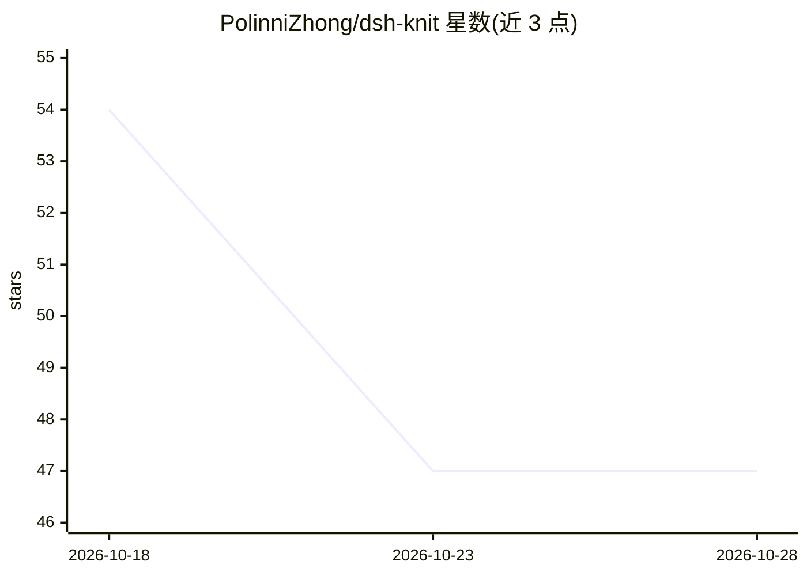

# PolinniZhong/dsh-knit

⭐ 47 · JavaScript · MIT · 推送 2026-10-16 · [GitHub](https://github.com/PolinniZhong/dsh-knit) · [官网](https://www.npmjs.com/package/dsh-knit) · 个人维护 · 中文 README

**给 AI Coding Agent 的本地任务感知上下文检索与追踪插件**

运行在 DSH（DeepSeek 宿主）里的插件：扫描会话工作区的文档、代码与媒体，按当前对话用 BM25+IDF 排序，组织成主要/辅助/相关三层的 Context Pack（每条附可核验的命中理由），通过面板展示并经 knit_docs 工具交给 agent；再持续追踪每篇文档是否被读、读后是否变更。默认词法模式纯本地字符串运算，不调模型、不联网；可选混合检索（默认关闭）需自行配置 Ollama 或 OpenAI 兼容 provider。代码检索限定首批后缀，正文只取前 8KB，代码候选上限 300。

## 筛选速览

| 维度 | 判定 | 备注 |
|---|---|---|
| AI 角色 | `ai-ecosystem` | LLM/agent 周边工具 |
| 许可风险 | `permissive` | MIT |
| 部署形态 | `library` | 以包/库形式分发 |
| 模型依赖 | local-ok | 支持本地模型 |
| 硬件要求 | — | 无带数字的原话,不猜 |
| 安装摩擦 | `low` | 无编译、无系统依赖或容器化 |
| 成熟度 | — | 结构信号不足 |

## 能力要点

- BM25+IDF 按当前对话相关性排序，默认纯本地零模型调用
- 主要/辅助/相关三层 Context Pack，每条理由可按行号核验
- knit_docs 工具把三层任务上下文交给 agent
- 文档生命周期追踪：未读/已读/读后已更新等状态

## 适用场景

- agent 产出文档过多时，按当前任务快速定位最相关的工作区内容
- 让 AI coding agent 通过 knit_docs 获取分层任务上下文而非平铺文件列表
- 追踪推荐文档是否被 agent 读取、读后是否被修改

## 场景标签

 · 领域:AI Agent 基础设施/开发工具

## 证据(README 行号)

> L8: 组织成 **主要 / 辅助 / 相关** 三层上下文（Context Pack），交给面板、也交给 agent；
> L11: **找到 → 组织 → 追踪**，默认的**词法模式**三步都在本机用字符串运算完成 —— 不调模型、不联网、零延迟、内容不出本机。
> L146: |**给 agent 用的 `knit_docs` 工具**：让模型拿回**三层任务上下文**（不是一条平铺列表）|✅|

## 星数曲线

2026-10-18 54 → 2026-10-28 47（-7）

---
*卡片 v1 · prompt 1.4 · 生成 2026-10-25 · 置信度 mid · 依据 README sha `36efca11765d` · [字段定义](../../DATASET.md)*
