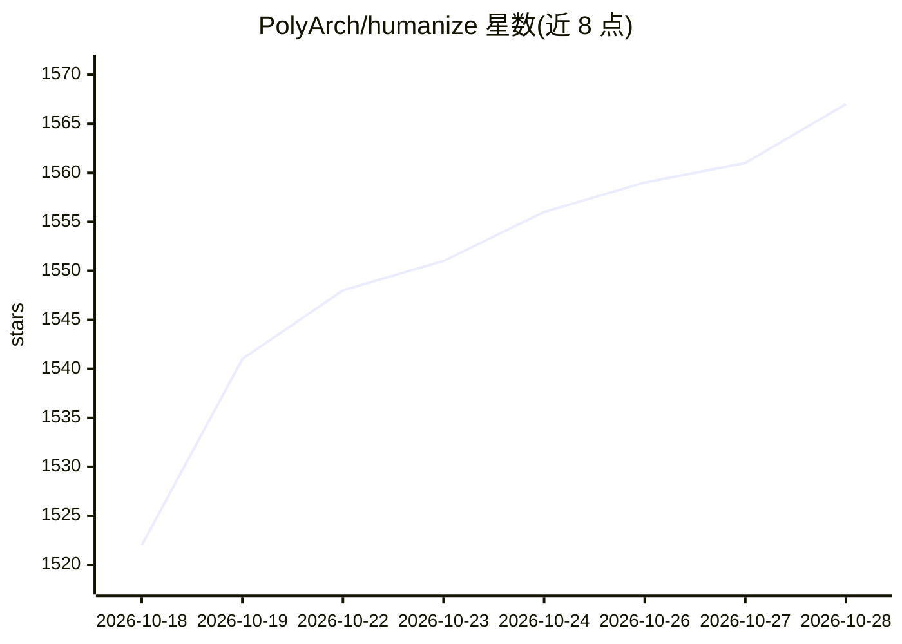

# PolyArch/humanize

⭐ 1,567 · Shell · 推送 2026-08-28 · [GitHub](https://github.com/PolyArch/humanize) · 组织维护

**给开发者的 Claude Code 插件：AI 实现与独立评审的迭代循环**

Humanize 是一个 Claude Code 插件，提供 RLCR（Ralph-Loop with Codex Review）迭代开发工作流：Claude 负责实现，Codex CLI 独立进行代码评审与严重度标记，问题反馈回实现阶段直至验收标准满足。包含想法草稿生成、计划生成与按注释精炼、可选 Agent Teams 并行、Gemini 深度网络调研（需 Gemini CLI）、终端监控面板。要求人在环路确认计划，安装需 Claude Code 插件市场与 codex CLI。

## 筛选速览

| 维度 | 判定 | 备注 |
|---|---|---|
| AI 角色 | `ai-ecosystem` | LLM/agent 周边工具 |
| 许可风险 | `none` | — |
| 部署形态 | `None` |  |
| 模型依赖 | locked-api |  |
| 硬件要求 | — | 无带数字的原话,不猜 |
| 安装摩擦 | `low` | 无编译、无系统依赖或容器化 |
| 成熟度 | `idea` | |

## 能力要点

- RLCR 循环：Claude 实现 + Codex 独立评审，直至验收标准满足
- gen-idea/gen-plan/refine-plan 命令链，支持并行探索方向（默认 6 个）
- 可选 Agent Teams 并行与 Swarm 模式迭代精炼
- humanize monitor 终端监控 RLCR/skill/codex/gemini 调用

## 适用场景

- 在 Claude Code 中以实现-评审反馈循环推进编码任务
- 从粗略想法生成草稿与计划并按评审注释精炼
- 监控 RLCR 循环与外部 CLI 调用进度

## 场景标签

`编码 Agent` `代码审查` `多智能体` · 领域:Agent 开发

## 证据(README 行号)

> L10: A Claude Code plugin that provides iterative development with independent AI review. Build with confidence through 
> L14: **RLCR** stands for **Ralph-Loop with Codex Review**, inspired by the official ralph-loop plugin and enhanced with 
> L27: The loop has two phases: **Implementation** (Claude works, Codex reviews summaries) and **Code Review** (Codex chec

## 星数曲线

2026-10-18 1,522 → 2026-10-28 1,567（+45）

---
*卡片 v1 · prompt 1.4 · 生成 2026-10-21 · 置信度 high · 依据 README sha `c08648d1df10` · [字段定义](../../DATASET.md)*
