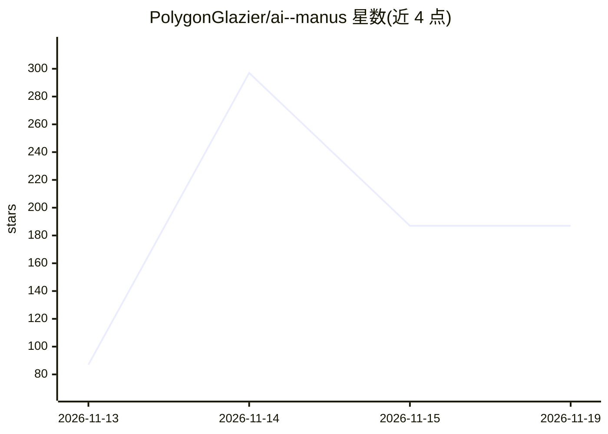

# PolygonGlazier/ai--manus

⭐ 187 · Apache-2.0 · 推送 2026-11-15 · [GitHub](https://github.com/PolygonGlazier/ai--manus) · 个人维护

**自主执行代码与控制浏览器的通用 AI Agent，面向日常小任务**

以 AI agent 为本体的自动化助手：自行编写并执行脚本、控制浏览器完成导航/填表/信息收集，并跨会话记忆工作流模式，可承担多步骤任务。定位为家庭、学习与轻量办公场景的助手，而非企业平台。README 描述了配置、测试、维护的入门流程与硬件兼容表，但未给出具体安装命令、依赖或模型接入方式，实现细节无法验证。

## 筛选速览

| 维度 | 判定 | 备注 |
|---|---|---|
| AI 角色 | `ai-native` | 本体是模型或模型工具 |
| 许可风险 | `permissive` | Apache-2.0 |
| 部署形态 | `None` |  |
| 模型依赖 | — | README 未给出锁定关系 |
| 硬件要求 | — | 无带数字的原话,不猜 |
| 安装摩擦 | `low` | 无编译、无系统依赖或容器化 |
| 成熟度 | — | 结构信号不足 |

## 能力要点

- agent 可自主编写并执行代码
- 浏览器控制：导航、填表、跨页面信息收集
- 跨会话记忆工作流模式，支持代码与浏览器任务衔接

## 适用场景

- 让 agent 代为完成重复性的代码与网页操作
- 学习与研究中收集资料、整理笔记、跑小脚本
- 日常小项目里委派多步骤任务

## 场景标签

`浏览器自动化` `AI 助手` · 领域:效率与自动化

## 证据(README 行号)

> L10: - **Autonomous Code Execution:** Manus AI agent runs code on its own to complete tasks, so you can focus on decisio
> L18: Manus is an autonomous AI agent designed to run code and control a browser on your behalf. Instead of acting like a
> L22: Manus is not a heavy studio suite or a complex enterprise platform. It is a focused helper built for home, study, a

## 星数曲线

2026-11-13 87 → 2026-11-19 187（+100）

---
*卡片 v1 · prompt 1.4 · 生成 2026-11-17 · 置信度 mid · 依据 README sha `0f78ee3a5dd2` · [字段定义](../../DATASET.md)*
