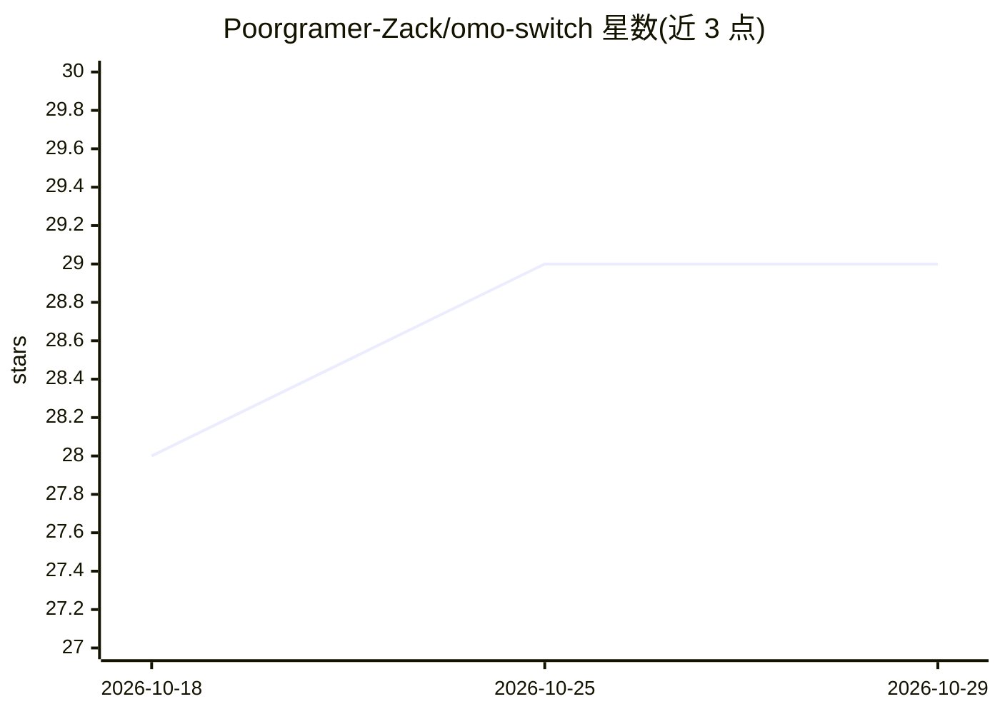

# Poorgramer-Zack/omo-switch

⭐ 29 · TypeScript · MIT · 推送 2026-04-13 · [GitHub](https://github.com/Poorgramer-Zack/omo-switch) · [官网](https://www.npmjs.com/package/omo-switch-cli) · 个人维护

**oh-my-opencode 配置档案切换 CLI 工具**

一个轻量 CLI，用于管理 oh-my-opencode / oh-my-opencode-slim 的配置档案：支持 OMO 多文件模式与 OMOS 单文件预设模式的添加、列表、查看、应用与删除，区分 user 全局与 project 项目两个作用域，切换前自动备份并按官方 JSON schema 校验，无法联网时回退到内置 schema。面向使用 oh-my-opencode 的开发者日常开发工作流；复杂编排需求 README 建议使用 ocx。要求 Node.js >= 22.0.0，通过 npm 全局安装或从源码构建。

## 筛选速览

| 维度 | 判定 | 备注 |
|---|---|---|
| AI 角色 | `ai-ecosystem` | LLM/agent 周边工具 |
| 许可风险 | `permissive` | MIT |
| 部署形态 | `library` | 以包/库形式分发 |
| 模型依赖 | — | README 未给出锁定关系 |
| 硬件要求 | — | 无带数字的原话,不猜 |
| 安装摩擦 | `low` | 无编译、无系统依赖或容器化 |
| 成熟度 | — | 结构信号不足 |

## 能力要点

- OMO 多文件 / OMOS 单文件预设双模式切换
- user 与 project 双作用域管理，支持 Git 共享项目配置
- 变更前自动备份并按官方 JSON schema 校验
- 跨平台（Windows/Linux/macOS，XDG 兼容），离线可用内置 schema

## 适用场景

- 在多套 oh-my-opencode 配置间一键切换
- 为不同项目维护独立配置并随仓库共享
- 切换前自动备份，避免配置被覆盖丢失

## 场景标签

 · 领域:开发工具/配置管理

## 证据(README 行号)

> L8: A CLI tool for managing oh-my-opencode configuration profiles.
> L12: `omo-switch` is designed as a simple, lightweight tool dedicated purely to switching between different configuratio
> L171: Validates and applies the selected profile to the `oh-my-opencode` target configuration.

## 星数曲线

2026-10-18 28 → 2026-10-29 29（+1）

---
*卡片 v1 · prompt 1.4 · 生成 2026-10-26 · 置信度 high · 依据 README sha `226fa89c8de1` · [字段定义](../../DATASET.md)*
