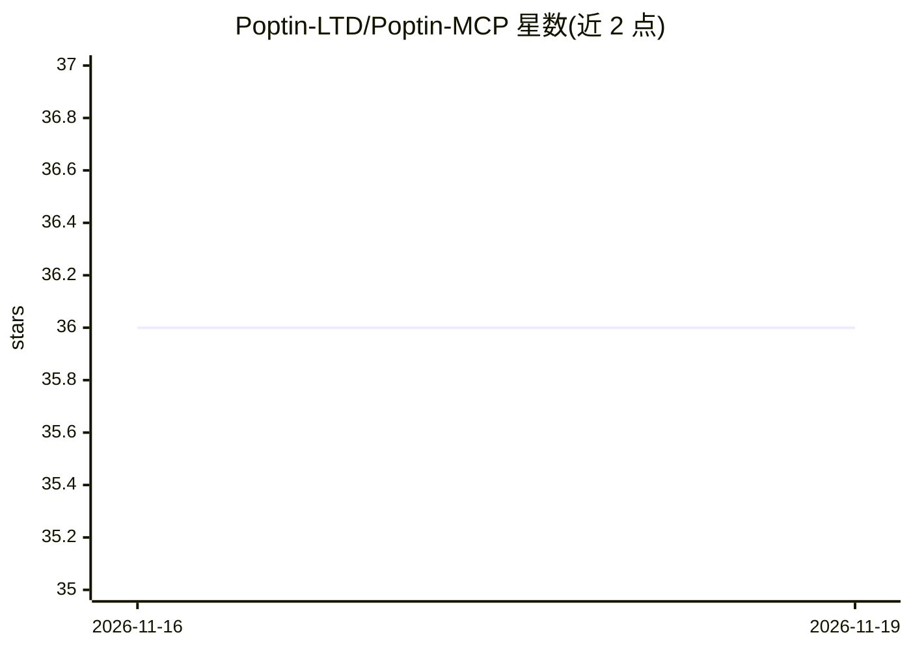

# Poptin-LTD/Poptin-MCP

⭐ 36 · MIT · 推送 2026-11-17 · [GitHub](https://github.com/Poptin-LTD/Poptin-MCP) · [官网](https://poptin.com/) · 组织维护

**面向 Poptin 营销账户的官方 MCP 服务器**

Poptin 官方托管的 MCP 服务器，通过 Streamable HTTP 与 OAuth 让 AI 客户端操作用户的 Poptin 账户：创建与发送邮件营销活动、分析弹窗与表单的浏览/转化数据、构建受众分群、管理现有弹窗表单与联系人属性。服务器由 Poptin 托管，仓库仅含文档与注册元数据，无需本地安装；发送/排期邮件需显式确认。限制：暂不支持通过 MCP 创建弹窗或编辑其视觉设计，API key 不能用于认证。

## 筛选速览

| 维度 | 判定 | 备注 |
|---|---|---|
| AI 角色 | `ai-ecosystem` | LLM/agent 周边工具 |
| 许可风险 | `permissive` | MIT |
| 部署形态 | `None` |  |
| 模型依赖 | — | README 未给出锁定关系 |
| 硬件要求 | — | 无带数字的原话,不猜 |
| 安装摩擦 | `low` | 无编译、无系统依赖或容器化 |
| 成熟度 | — | 结构信号不足 |

## 能力要点

- 自然语言创建、测试、发送或排期邮件营销活动
- 分析弹窗、表单与邮件活动的转化表现（按设备/流量来源）
- 基于联系人属性、订阅状态与客户活动构建可复用分群
- Poptin 托管服务器，Streamable HTTP + OAuth 连接，无需本地部署

## 适用场景

- 让 AI 助手帮我准备并发送邮件营销活动
- 用对话查询哪些弹窗转化率最高
- 构建可复用的受众分群供营销使用

## 场景标签

 · 领域:营销自动化/MCP 集成

## 证据(README 行号)

> L17: **Poptin MCP is the official connection between your AI agent and your
> L18: Poptin account, so you can create email campaigns, analyze performance, and manage your marketing using natural lan
> L149: No. Poptin runs the server at `https://mcp.popt.in/mcp`. Your client connects to
> L150: it directly. This repository contains public documentation, registry metadata,

## 星数曲线

2026-11-16 36 → 2026-11-19 36（+0）

---
*卡片 v1 · prompt 1.4 · 生成 2026-11-18 · 置信度 high · 依据 README sha `734694e7218b` · [字段定义](../../DATASET.md)*
