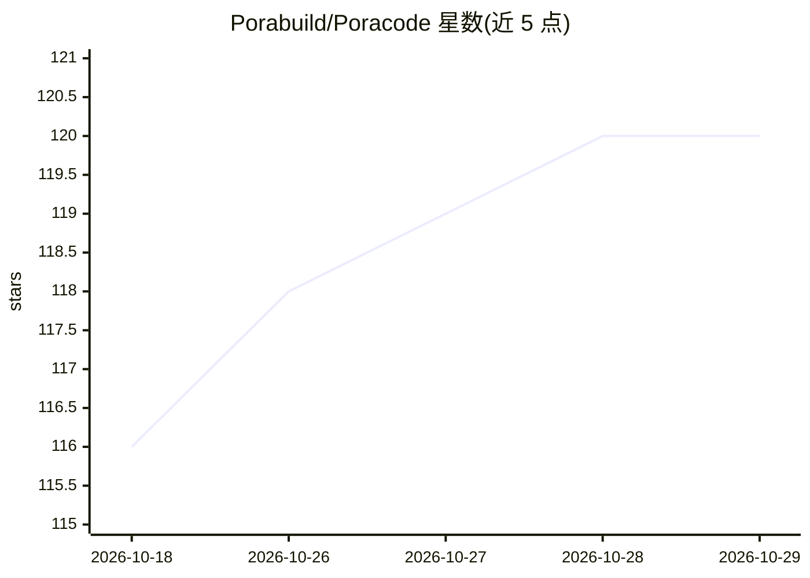

# Porabuild/Poracode

⭐ 120 · TypeScript · Apache-2.0 · 推送 2026-10-28 · [GitHub](https://github.com/Porabuild/Poracode) · [官网](https://poracode.com) · 组织维护

**单一窗口并行运行多种 AI 编程 agent 的桌面客户端**

桌面应用，将 Claude、Codex、Gemini、Cursor、Copilot 等多种 AI 编程 agent 集中在同一窗口并行运行，支持 TUI 与 GUI agent 混排的任意布局。提供统一聊天界面（ACP 与 SDK agent）、内置 MCP 服务器让 agent 操控应用本身、跨 agent 委派、并行 worktree 实验对比、定时任务、Git worktree/PR 管理、检查点回滚、内置浏览器与 Monaco 编辑器，以及 SSH 远程机器运行和独立服务器部署。用户自带订阅与 API key。提供 macOS/Windows/Linux 安装包。

## 筛选速览

| 维度 | 判定 | 备注 |
|---|---|---|
| AI 角色 | `ai-ecosystem` | LLM/agent 周边工具 |
| 许可风险 | `permissive` | Apache-2.0 |
| 部署形态 | `desktop` | 安装包/桌面程序 |
| 模型依赖 | locked-api |  |
| 硬件要求 | — | 无带数字的原话,不猜 |
| 安装摩擦 | `low` | 无编译、无系统依赖或容器化 |
| 成熟度 | — | 结构信号不足 |

## 能力要点

- 单窗口并行运行 14 种 AI 编程 agent 及 ACP registry 中任意 agent
- 内置 MCP 服务器：创建/操控线程、管理 Git worktree、提交同步、开 PR、定时运行
- 跨 agent 委派与并行 worktree 实验（AI judge 对比结果）
- 本地 Whisper 语音输入、SSH 远程机器运行、独立服务器（无 Electron）部署

## 适用场景

- 同时使用多个 AI 编程 agent 时统一管理会话与布局
- 让不同 agent 在各自 worktree 中并行处理同一任务并对比结果
- 通过手机/浏览器远程查看和操控桌面端 agent 线程

## 场景标签

`编码 Agent` · 领域:编码与开发

## 证据(README 行号)

> L6:  Run Claude, Codex, OpenCode, Gemini, Grok, Kimi Code, Qwen Code, Pi, Qoder, Factory Droid, Antigravity, Cursor, Com
> L36: Poracode ships its own MCP servers. Point any agent at them to create and steer threads, organize projects, list an

## 星数曲线

2026-10-18 116 → 2026-10-29 120（+4）

---
*卡片 v1 · prompt 1.4 · 生成 2026-10-23 · 置信度 high · 依据 README sha `4cc3b6cacfd0` · [字段定义](../../DATASET.md)*
