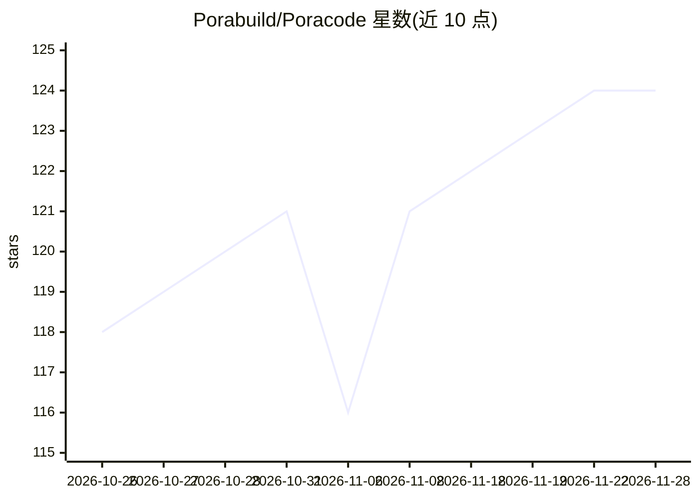

# Porabuild/Poracode

⭐ 124 · TypeScript · Apache-2.0 · 推送 2026-11-27 · [GitHub](https://github.com/Porabuild/Poracode) · [官网](https://poracode.com) · 组织维护

**把多个 AI 编码 agent 汇聚到同一窗口的桌面客户端**

桌面应用与 CLI，将 Claude Code、Codex、Gemini CLI 等多个 AI 编码 agent 并排运行在一个窗口内，支持 TUI/GUI 混合布局、会话持久化、后台并行任务。内置 MCP 服务器让 agent 操控应用本身（Git worktree、PR、调度），支持跨 agent 委派（Crossagents）、多 agent 同题对比并由 AI 评审择优、本地 Whisper 语音输入。采用 ACP（Agent Client Protocol）协议接入注册表中的任意 agent；需用户自备各 agent 的订阅与 API key。

## 筛选速览

| 维度 | 判定 | 备注 |
|---|---|---|
| AI 角色 | `ai-ecosystem` | LLM/agent 周边工具 |
| 许可风险 | `permissive` | Apache-2.0 |
| 部署形态 | `desktop` | 安装包/桌面程序 |
| 模型依赖 | — | README 未给出锁定关系 |
| 硬件要求 | — | 无带数字的原话,不猜 |
| 安装摩擦 | `low` | 无编译、无系统依赖或容器化 |
| 成熟度 | `idea` | |

## 能力要点

- 支持 15 个 AI 编码 agent 并排运行，另可从 ACP 注册表安装任意 agent
- 内置 MCP 服务器，agent 可创建会话、管理 Git worktree、开 PR、调度任务
- 多 agent 并行实验：同一 prompt 对比产出，AI 评审择优合并
- Whisper 本地语音输入、会话检查点回滚、远程访问与 SSH 远程机器

## 适用场景

- 同时使用多个编码 agent，想在一个窗口统一管理会话
- 让不同 provider 的 agent 相互委派或并行对比产出
- 定时运行夜间代码审查、依赖巡检等重复任务
- 通过手机或浏览器远程跟进桌面上的 agent 会话

## 场景标签

`多智能体` `编码 Agent` `代码审查` · 领域:Agent 开发

## 证据(README 行号)

> L5:  One window for all your AI coding agents.
> L28: A consistent chat interface for ACP and SDK agents — markdown, syntax highlighting, and tool call displays. Where a
> L116: Install and run any agent from the Agent Client Protocol registry directly from settings.

## 星数曲线

2026-10-26 118 → 2026-11-28 124（+6）

---
*卡片 v1 · prompt 1.4 · 生成 2026-11-28 · 置信度 high · 依据 README sha `dc54e5c66845` · [字段定义](../../DATASET.md)*
