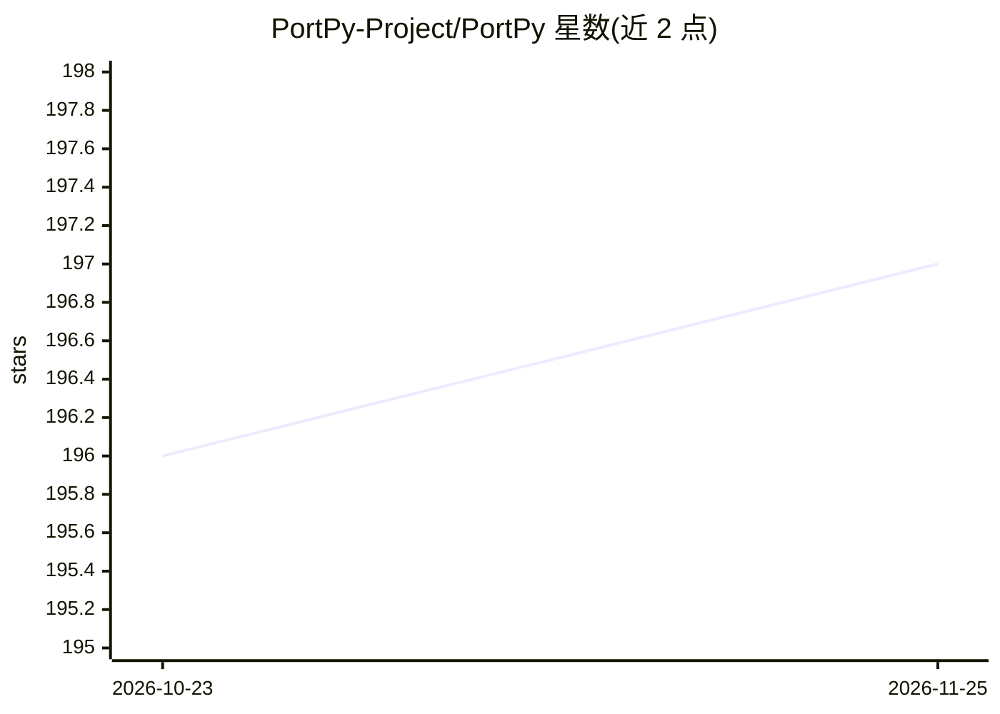

# PortPy-Project/PortPy

⭐ 197 · Python · NOASSERTION · 推送 2026-10-30 · [GitHub](https://github.com/PortPy-Project/PortPy) · 组织维护

**面向科研人员的癌症放疗计划优化研究 Python 平台**

开源 Python 平台，为医学物理、数学优化与 AI/ML 研究者提供放疗计划研究环境：内置 329 例（肺 200、前列腺 129）患者的临床级数据（剂量影响矩阵、专家选束、参考计划），提供 IMRT/VMAT 优化算法与深度学习剂量预测基线（3D U-Net、3D ViT、Swin UNETR），并以 CVXPY 编写优化问题使求解器可一行切换。计划可导出为 DICOM-RT 或 Eclipse 兼容格式导入临床 TPS。数据不随包分发，每位患者约 2–20 GB 需按需下载。

## 筛选速览

| 维度 | 判定 | 备注 |
|---|---|---|
| AI 角色 | `ai-native` | 本体是模型或模型工具 |
| 许可风险 | `none` | NOASSERTION |
| 部署形态 | `library` | 以包/库形式分发 |
| 模型依赖 | — | README 未给出锁定关系 |
| 硬件要求 | — | 无带数字的原话,不猜 |
| 安装摩擦 | `low` | 无编译、无系统依赖或容器化 |
| 成熟度 | — | 结构信号不足 |

## 能力要点

- 329 例患者的临床级数据集托管于 Hugging Face，含剂量影响矩阵与专家参考计划
- PortPy.AI 基准定义三个任务（束流剂量预测、总剂量预测、计划优化），评分最终可交付计划
- 优化问题用 CVXPY 编写，支持 MOSEK/Gurobi/SCS/Clarabel 等求解器切换
- 支持 DICOM-RT 导出及与 Varian Eclipse TPS 的双向集成

## 适用场景

- 在真实患者数据上研究 IMRT/VMAT 计划优化算法
- 训练并评测深度学习剂量预测模型（需 GPU）
- 将研究计划导出为 DICOM-RT 导入临床 TPS 复算
- 以冻结划分的公开基准对比 AI 计划算法

## 场景标签

`科研工具` `模型评测` · 领域:评测与运维

## 证据(README 行号)

> L20: **PortPy** is an open-source Python platform for **cancer radiotherapy treatment-planning research**.
> L67: - **An end-to-end AI benchmark.** PortPy.AI defines three tasks (beamlet-dose
> L131: (NeurIPS 2026, Evaluations and Datasets Track) tackles all three: a shared

## 星数曲线

2026-10-23 196 → 2026-11-25 197（+1）

---
*卡片 v1 · prompt 1.4 · 生成 2026-11-25 · 置信度 high · 依据 README sha `9e925b311580` · [字段定义](../../DATASET.md)*
