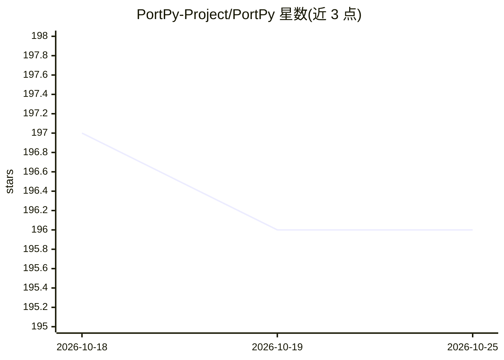

# PortPy-Project/PortPy

⭐ 196 · Python · NOASSERTION · 推送 2026-10-22 · [GitHub](https://github.com/PortPy-Project/PortPy) · 组织维护

**面向科研的癌症放疗计划优化 Python 库与基准数据集**

为放疗治疗计划研究提供的开源 Python 库：包含数据管理、计划生成、计划评估三大模块，支持读取 100 例肺癌与 129 例前列腺癌患者的基准数据（CT、轮廓、射束、剂量影响矩阵、ECHO 基准 IMRT 计划），通过集成 CVXPy 做凸优化与混合整数规划求全局最优，另提供 PortPy.AI 模块做剂量预测的模型训练测试。限制：当前版本只能使用自带基准数据集，不能导入自有数据。附 Jupyter 教程与 AAPM'23 论文。

## 筛选速览

| 维度 | 判定 | 备注 |
|---|---|---|
| AI 角色 | `ai-native` | 本体是模型或模型工具 |
| 许可风险 | `none` | NOASSERTION |
| 部署形态 | `library` | 以包/库形式分发 |
| 模型依赖 | — | README 未给出锁定关系 |
| 硬件要求 | — | 无带数字的原话,不猜 |
| 安装摩擦 | `low` | 无编译、无系统依赖或容器化 |
| 成熟度 | — | 结构信号不足 |

## 能力要点

- 100 肺癌 + 129 前列腺癌患者基准数据集（Eclipse TPS 提取）
- 集成 CVXPy，可调用 SCIP/MOSEK/CPLEX/GUROBI 等求解器
- PortPy.AI 模块支持深度学习 3D 剂量预测并转为可执行计划
- VMAT/射束角/DVH 约束等问题的全局最优基准算法

## 适用场景

- 开发并验证新型放疗计划优化算法
- 在标准化患者数据集上做剂量预测模型训练测试
- 按临床协议定量评估与可视化治疗计划

## 场景标签

`科研工具` `教程课程` · 领域:学习与行业

## 证据(README 行号)

> L48: |vmat_scp_dose_prediction.ipynb|Predicts 3D dose distribution using deep learning and converts it into a deliverabl
> L101:  * PortPy.AI module is equipped with essential functionalities for AI-based planning. These include data access,
> L102: data pre-processing, model training and testing, and patient-specific 3D dose prediction

## 星数曲线

2026-10-18 197 → 2026-10-25 196（-1）

---
*卡片 v1 · prompt 1.4 · 生成 2026-10-22 · 置信度 mid · 依据 README sha `aa3f59238b64` · [字段定义](../../DATASET.md)*
