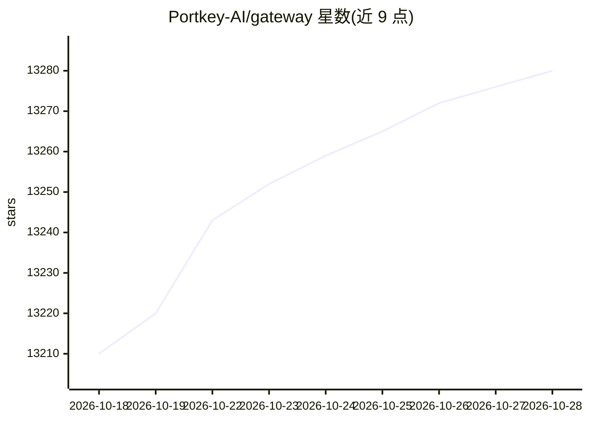

# Portkey-AI/gateway

⭐ 13,288 · TypeScript · MIT · 推送 2026-05-25 · [GitHub](https://github.com/Portkey-AI/gateway) · [官网](https://portkey.ai/features/ai-gateway) · 组织维护

**为开发者提供统一的 AI 网关，路由 1600+ 模型并集成 guardrails**

开源 AI Gateway，通过单一 API 将请求路由到 1600+ 语言、视觉、音频与图像模型。核心机制包括自动重试与 fallback、负载均衡与条件路由、40+ 预置 guardrails、虚拟密钥管理与用量分析；另提供 MCP Gateway 作为组织级 MCP 服务器的集中控制平面（认证、访问控制、可观测性）。通过 npx 本地运行，支持 Docker、Cloudflare 等多种部署方式；部分功能（语义缓存、prompt 管理等）仅 hosted/企业版提供。

## 筛选速览

| 维度 | 判定 | 备注 |
|---|---|---|
| AI 角色 | `ai-native` | 本体是模型或模型工具 |
| 许可风险 | `permissive` | MIT |
| 部署形态 | `library` | 以包/库形式分发 |
| 模型依赖 | local-ok | 支持本地模型 |
| 硬件要求 | — | 无带数字的原话,不猜 |
| 安装摩擦 | `low` | 无编译、无系统依赖或容器化 |
| 成熟度 | — | 结构信号不足 |

## 动量与使用信号

- 维护:`maintenance` — 距上次 push 145.8 天,年发版 8,102 位贡献者
- 涨星:近 1 天 **+13**(自 20261016 起算)
- 安装:pypi 包 `portkey-ai` 月下载 3,949,020
- 平台:— · 协议:OPENAI-API / MCP / OLLAMA

## 能力要点

- 单一 API 路由 1600+ 多模态模型，支持 45+ provider
- fallback、自动重试、负载均衡等可靠路由机制
- 40+ 预置 guardrails 验证 LLM 输入输出
- MCP Gateway 提供集中认证、访问控制与调用日志

## 适用场景

- 在多个 LLM provider 之间做故障切换与负载均衡
- 为 AI 应用统一添加输入输出 guardrails
- 集中管理组织的 MCP 服务器访问权限与调用日志
- 本地或私有化部署 LLM 网关

## 场景标签

`模型网关` `LLM 可观测性` · 领域:Agent 开发

## 证据(README 行号)

> L24: The **AI Gateway** is designed for fast, reliable & secure routing to 1600+ language, vision, audio, and image mode
> L37: - Manage MCP servers with enterprise auth & observability using **MCP Gateway**

## 星数曲线

2026-10-18 13,210 → 2026-10-28 13,280（+70）

---
*卡片 v1 · prompt 1.4 · 生成 2026-10-18 · 置信度 mid · 依据 README sha `b58b1702c64a` · [字段定义](../../DATASET.md)*
