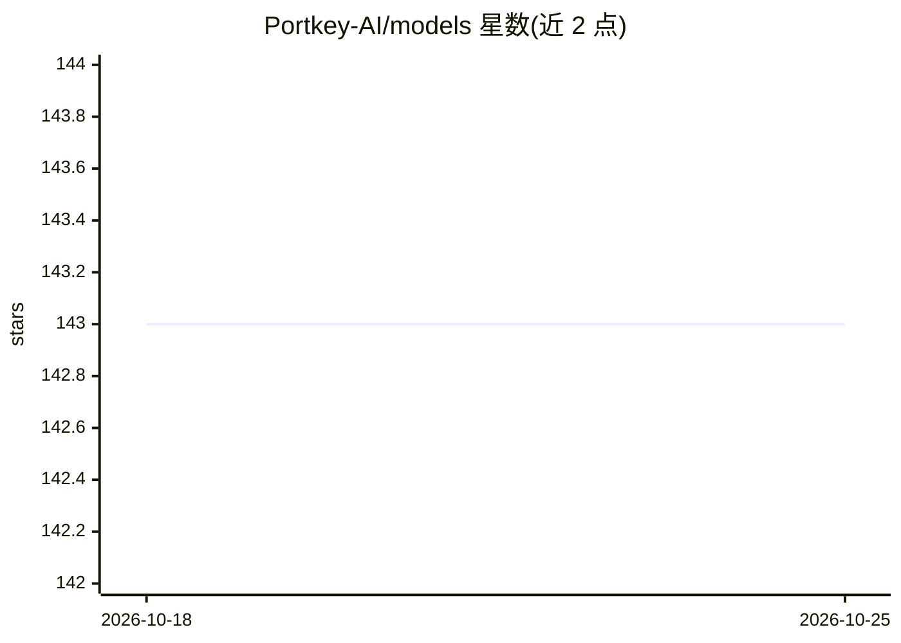

# Portkey-AI/models

⭐ 143 · JavaScript · MIT · 推送 2026-10-25 · [GitHub](https://github.com/Portkey-AI/models) · [官网](https://portkey.ai/models) · 组织维护

**2,000+ LLM 的定价与配置开放数据库，免费 API 提供**

由 Portkey 维护的社区数据库，收录 2,000+ 模型、40+ 提供商的定价与配置数据，为 Portkey AI Gateway 的成本归因提供支撑。提供免认证的 REST API，可按提供商获取 JSON 定价数据或查询单个模型配置。Schema 覆盖输入/输出 token、缓存读写、音视频与图像等计费维度，并含各提供商特有计费单位与 Batch 定价字段。价格单位为美分每 token，需除以 100 换算美元。

## 筛选速览

| 维度 | 判定 | 备注 |
|---|---|---|
| AI 角色 | `ai-knowledge` | 知识聚合/清单类 |
| 许可风险 | `permissive` | MIT |
| 部署形态 | `None` |  |
| 模型依赖 | — | README 未给出锁定关系 |
| 硬件要求 | — | 无带数字的原话,不猜 |
| 安装摩擦 | `low` | 无编译、无系统依赖或容器化 |
| 成熟度 | — | 结构信号不足 |

## 能力要点

- 覆盖 2,000+ 模型、40+ 提供商的定价与配置数据
- 免认证免费 API：按提供商或按模型查询 JSON 定价
- Schema 覆盖缓存读写、音频/图像/视频等附加计费单位
- 支持 OpenAI/Anthropic/Google 的 batch_config 批量定价字段

## 适用场景

- 为 LLM 应用做成本核算与价格换算，替代自维护表格
- 网关或计费系统接入统一的多提供商定价数据源
- 查询某模型含缓存、附加能力的完整计费维度

## 场景标签

 · 领域:LLM 基础设施/数据

## 证据(README 行号)

> L3:  Accurate pricing for 2,000+ models across 40+ providers. Free API, no auth required.
> L11: This repository contains comprehensive pricing and configuration data for LLMs. It powers cost attribution for 200+
> L22: We built this as an open, community-maintained database to solve that problem.

## 星数曲线

2026-10-18 143 → 2026-10-25 143（+0）

---
*卡片 v1 · prompt 1.4 · 生成 2026-10-22 · 置信度 high · 依据 README sha `9628edf34886` · [字段定义](../../DATASET.md)*
