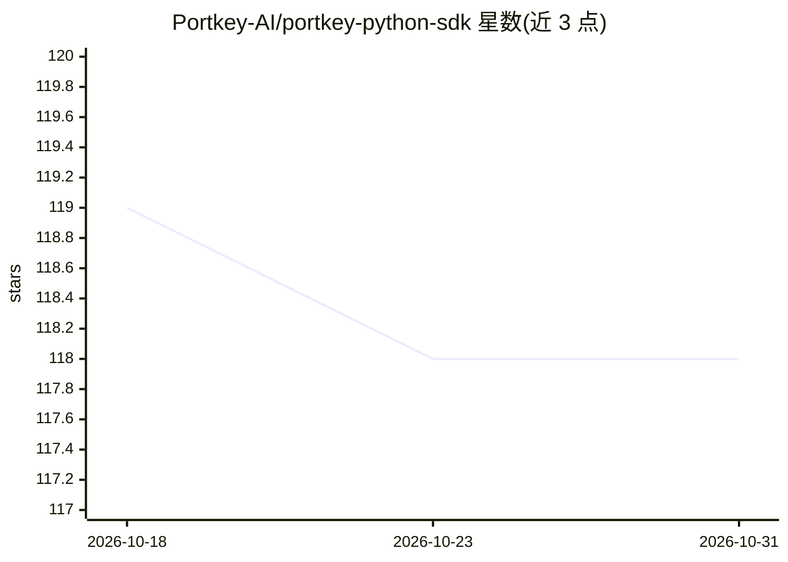

# Portkey-AI/portkey-python-sdk

⭐ 118 · Python · MIT · 推送 2026-07-23 · [GitHub](https://github.com/Portkey-AI/portkey-python-sdk) · [官网](https://portkey.ai/docs) · 组织维护

**Portkey AI 网关的 Python SDK：统一接口接入多 LLM 提供商**

Portkey 官方 Python SDK，构建在 OpenAI SDK 之上，保持 OpenAI 方法签名兼容，替换一行 import 即可接入。功能包括 AI 网关（统一 API 签名、跨提供商切换、自动降级重试、负载均衡、语义缓存、虚拟密钥、请求超时）与可观测性（日志、请求追踪、自定义元数据、反馈收集、40+ 指标分析）。另提供 Strands Agents 与 Google ADK 可选集成适配器，需注册 Portkey 账号并使用 Portkey API Key。

## 筛选速览

| 维度 | 判定 | 备注 |
|---|---|---|
| AI 角色 | `ai-ecosystem` | LLM/agent 周边工具 |
| 许可风险 | `permissive` | MIT |
| 部署形态 | `library` | 以包/库形式分发 |
| 模型依赖 | — | README 未给出锁定关系 |
| 硬件要求 | — | 无带数字的原话,不猜 |
| 安装摩擦 | `low` | 无编译、无系统依赖或容器化 |
| 成熟度 | — | 结构信号不足 |

## 能力要点

- 兼容 OpenAI SDK 全部方法签名，含 legacy 方法
- AI 网关：自动降级/重试、负载均衡、语义缓存、虚拟密钥
- 可观测性：日志、请求追踪、反馈与 40+ 生产指标
- Strands Agents 与 Google ADK 可选集成适配器

## 适用场景

- 在不改动现有 OpenAI 代码的情况下切换 LLM 提供商
- 为 LLM 应用添加降级、重试与负载均衡
- 对生产环境 LLM 请求做日志追踪与指标分析

## 场景标签

`模型网关` `LLM 可观测性` · 领域:Agent 开发

## 证据(README 行号)

> L8: The Portkey SDK is built on top of the OpenAI SDK, allowing you to seamlessly integrate Portkey's advanced features 
> L10: ### AI Gateway
> L23: ### Observability

## 星数曲线

2026-10-18 119 → 2026-10-31 118（-1）

---
*卡片 v1 · prompt 1.4 · 生成 2026-10-23 · 置信度 high · 依据 README sha `0ef14f977231` · [字段定义](../../DATASET.md)*
