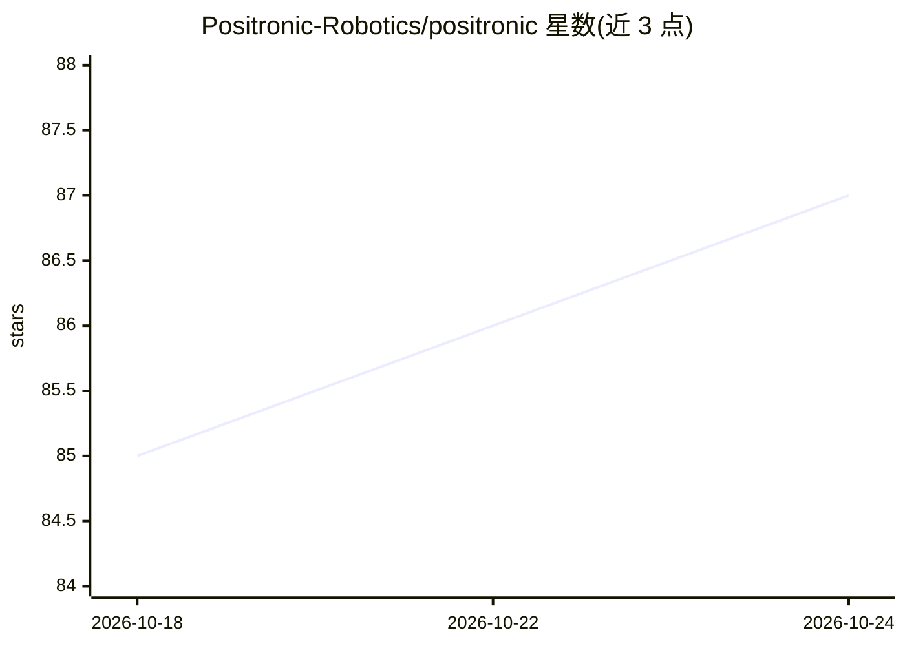

# Positronic-Robotics/positronic

⭐ 87 · Python · Apache-2.0 · 推送 2026-10-23 · [GitHub](https://github.com/Positronic-Robotics/positronic) · [官网](https://positronic.ro/) · 组织维护

**Python 原生机器人 ML 工具链：硬件接入、数据采集与 VLA 模型评测部署**

面向构建机器人操作系统的团队的开源工具链，覆盖完整生命周期：硬件上线、数据采集与整理、策略训练与评测、推理部署与迭代。全部子系统以纯 Python 实现，无需 ROS。数据集库支持一次存储多格式转换（LeRobot/GR00T/OpenPI），统一推理 API 通过 WebSocket/gRPC 跨供应商运行。支持 OpenPI、GR00T、LeRobot（ACT/SmolVLA）等模型，训练通过 Docker 服务进行。项目处于 alpha 阶段，API 可能变化。

## 筛选速览

| 维度 | 判定 | 备注 |
|---|---|---|
| AI 角色 | `ai-ecosystem` | LLM/agent 周边工具 |
| 许可风险 | `permissive` | Apache-2.0 |
| 部署形态 | `self-host` | docker 或自建部署 |
| 模型依赖 | — | README 未给出锁定关系 |
| 硬件要求 | — | 无带数字的原话,不猜 |
| 安装摩擦 | `low` | 无编译、无系统依赖或容器化 |
| 成熟度 | `idea` | |

## 能力要点

- 统一推理 API：一套会话协议跨 LeRobot/GR00T/OpenPI 服务器
- 数据集一次存储，经 codec 懒转换到多种模型格式无需重录
- 支持 OpenPI、GR00T N1.7、LeRobot ACT/SmolVLA 等模型工作流
- 纯 Python 实现，无需 ROS，含 MuJoCo 仿真与手机遥操作数据采集

## 适用场景

- 采集和管理机器人演示数据并转换到不同训练框架格式
- 在仿真和真机上评测 VLA 模型策略
- 在不同模型供应商间切换而不改硬件代码

## 场景标签

`模型评测` `推理引擎` · 领域:评测与运维

## 证据(README 行号)

> L33: Positronic is an end-to-end toolkit for building ML-driven robotics systems.
> L35: It covers the full lifecycle: bring new hardware online, capture and curate datasets, train and evaluate policies, 

## 星数曲线

2026-10-18 85 → 2026-10-24 87（+2）

---
*卡片 v1 · prompt 1.4 · 生成 2026-10-23 · 置信度 high · 依据 README sha `e3bf361c5308` · [字段定义](../../DATASET.md)*
