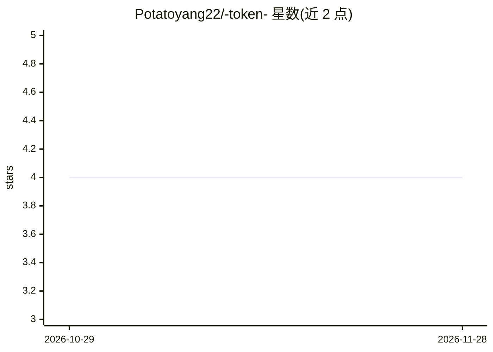

# Potatoyang22/-token-

⭐ 4 · JavaScript · MIT · 推送 2026-10-28 · [GitHub](https://github.com/Potatoyang22/-token-) · 个人维护 · 中文 README

**本地优先的 LLM 余额与 token 用量桌面监控挂件**

基于 Electron 的本地优先监控器：桌面挂件显示蓝色鲸鱼，通过只读监听 Codex 本地会话日志和本地 OpenAI-compatible 代理捕获真实请求用量，以气泡动画展示余额扣减与 token 消耗。支持 DeepSeek、OpenRouter 及自定义 JSON 余额接口查询，面板展示今日消费、输入/输出 token、缓存命中、平均延迟与模型分布。API Key 经 Electron safeStorage 用系统安全存储加密，不保存 prompt 与响应正文。Windows 提供安装包，也支持源码运行。

## 筛选速览

| 维度 | 判定 | 备注 |
|---|---|---|
| AI 角色 | `ai-enhanced` | 去掉 AI 部分产品仍成立 |
| 许可风险 | `permissive` | MIT |
| 部署形态 | `library` | 以包/库形式分发 |
| 模型依赖 | locked-api |  |
| 硬件要求 | — | 无带数字的原话,不猜 |
| 安装摩擦 | `low` | 无编译、无系统依赖或容器化 |
| 成熟度 | — | 结构信号不足 |

## 能力要点

- 只读监听 Codex 本地会话日志，不调用模型、不产生额外 token
- 本地 OpenAI-compatible 代理（127.0.0.1:8787）从响应/SSE 读取 usage，缺失时按字符估算
- DeepSeek/OpenRouter 余额查询及自定义 JSON 字段路径接口
- API Key 经系统安全存储加密，仅保存用量元数据

## 适用场景

- 桌面上实时查看 Codex 调用产生的余额扣减与 token 用量
- 给 OpenAI 兼容客户端配置本地代理统计请求用量
- 按天追踪今日消费、延迟与模型分布

## 场景标签

 · 领域:开发工具/LLM 用量监控

## 证据(README 行号)

> L5: 一个本地优先的大模型余额、费用和 token 监控器。桌面挂件只保留图库中的蓝色鲸鱼，余额与扣费以小气泡的形式贴近鲸鱼显示；完整数据面板仍参考 Token Monitor 的信息层级。
> L31: - Codex 本地只读监听：读取 `~/.codex/sessions/**/*.jsonl` 中的 `token_usage_record`
> L44: - 本地 OpenAI-compatible 代理：`http://127.0.0.1:8787/v1`

## 星数曲线

2026-10-29 4 → 2026-11-28 4（+0）

---
*卡片 v1 · prompt 1.4 · 生成 2026-11-21 · 置信度 high · 依据 README sha `93e8eff2e5e5` · [字段定义](../../DATASET.md)*
