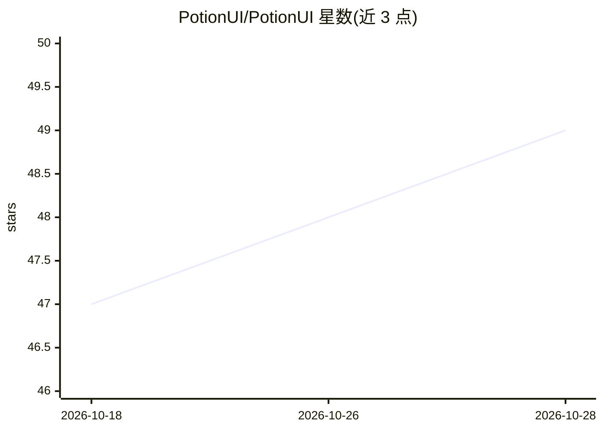

# PotionUI/PotionUI

⭐ 49 · Python · GPL-3.0 · 推送 2026-10-27 · [GitHub](https://github.com/PotionUI/PotionUI) · [官网](https://potionui.com) · 组织维护

**自托管多用户生成工作室：一台 GPU 跑图像/视频/音频扩散模型**

面向团队、家庭或 agent 共享的单机生成平台：在本地 GPU 上运行 SDXL、Flux、Krea-2、Wan、LTX、MiniMax、YuE2 等扩散模型，生成图像、视频与音乐，无需节点连线或逐模型配置。提供多用户账户、组与管理面板，可按用户/组分配预设、模型与 LLM 配置；通过每用户 MCP token 允许 Claude Desktop 等客户端驱动实例。内置生成助手（支持 Ollama、OpenRouter 等 LLM 后端）、Video Director 分段编排、历史/收藏、可视化自动化与插件系统。目前处于 alpha（0.0.17），Linux x86_64 + NVIDIA 为已测试平台，Windows 原生为实验性，macOS 与 ROCm 不支持。

## 筛选速览

| 维度 | 判定 | 备注 |
|---|---|---|
| AI 角色 | `ai-native` | 本体是模型或模型工具 |
| 许可风险 | `viral` | GPL-3.0 |
| 部署形态 | `self-host` | docker 或自建部署 |
| 模型依赖 | local-ok | 支持本地模型 |
| 硬件要求 | `gpu-8g` | |
| 安装摩擦 | `low` | 无编译、无系统依赖或容器化 |
| 成熟度 | `idea` | |

## 能力要点

- 单机运行 SDXL/Flux/Krea-2/Wan/LTX/MiniMax/YuE2 等 13 类模型家族，图像、视频、音频统一界面
- 多用户账户、组与管理面板，按用户分配预设、模型与 LLM 配置
- 每用户 MCP token，可由 Claude Desktop 等 MCP 客户端驱动（写操作需批准）
- 插件化架构：ComfyUI 后端、云端模型 provider、自动化触发器等均为插件

## 适用场景

- 在自家 GPU 上搭建可分发给团队或家人的图像/视频/音频生成站
- 按用户分配可用模型与预设，控制资源与访问
- 通过 Claude Desktop 或 agent 以 MCP 方式调用本地生成能力
- 用 Video Director 分段编排视频镜头并链式生成

## 场景标签

`图像生成` `视频生成` · 领域:内容生成

## 证据(README 行号)

> L21: Run Krea-2, Anima, SDXL, Flux, Wan, LTX, Qwen-Image, MiniMax and YuE2 on one box — then give your team, your househ
> L7: Images, video and music on your own GPU · Free and open source · Linux & Windows
> L47: git clone https://github.com/PotionUI/PotionUI.git potionui && cd potionui

## 星数曲线

2026-10-18 47 → 2026-10-28 49（+2）

---
*卡片 v1 · prompt 1.4 · 生成 2026-10-25 · 置信度 high · 依据 README sha `b611e02dcbcc` · [字段定义](../../DATASET.md)*
