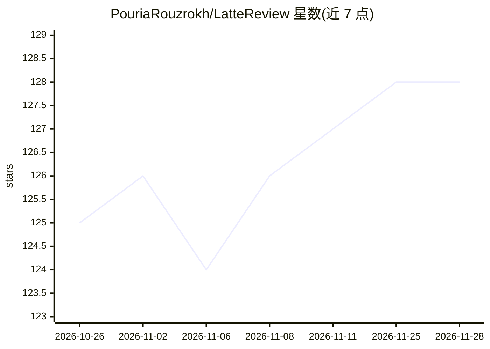

# PouriaRouzrokh/LatteReview

⭐ 128 · Jupyter Notebook · NOASSERTION · 推送 2026-11-17 · [GitHub](https://github.com/PouriaRouzrokh/LatteReview) · [官网](https://pouriarouzrokh.github.io/LatteReview) · 个人维护

**用多 AI agent 自动化系统综述筛选的 Python 低代码包**

LatteReview 是一个低代码 Python 包，通过多 AI reviewer agent 自动化学术文献的系统综述流程，支持标题/摘要筛选、打分、概念抽取、图像内容评审，以及 RIS 文献格式读取。核心机制包括多轮层级评审工作流、agent 间互评投票与修正、RAG 上下文注入、异步批处理与成本追踪。除 LLM 评审外，还支持决策模型（pplx-decider、Jev、gpt-6-luna）返回概率，用于低成本初筛并可配置混合流水线。需要 Python 3.10+，主要面向 API 付费模型，本地模型经 Ollama 使用。

## 筛选速览

| 维度 | 判定 | 备注 |
|---|---|---|
| AI 角色 | `ai-native` | 本体是模型或模型工具 |
| 许可风险 | `none` | NOASSERTION |
| 部署形态 | `library` | 以包/库形式分发 |
| 模型依赖 | local-ok | 支持本地模型 |
| 硬件要求 | — | 无带数字的原话,不猜 |
| 安装摩擦 | `low` | 无编译、无系统依赖或容器化 |
| 成熟度 | — | 结构信号不足 |

## 能力要点

- 多 agent 多轮层级评审工作流，支持并行/串行编排与互评投票
- 决策模型评审器返回概率，可按目标召回率拟合阈值做混合初筛
- 通过 LiteLLM 与多家模型商集成，含 OllamaProvider 本地模型路径
- 支持 RIS 格式读取与图像内容评审，内置成本追踪

## 适用场景

- 系统性综述的题目/摘要自动筛选
- 对大批文献做数据抽取与概念标注
- 先用决策模型初筛、再让 LLM 复核不确定文献以控制成本

## 场景标签

`科研工具` `多智能体` · 领域:Agent 开发

## 证据(README 行号)

> L14: LatteReview is a powerful Python package designed to automate academic literature review processes through AI-power
> L60: - Multi-agent review system with customizable roles and expertise levels for each reviewer
> L67: - Broad compatibility with LLM providers through LiteLLM, including OpenAI and Ollama

## 星数曲线

2026-10-26 125 → 2026-11-28 128（+3）

---
*卡片 v1 · prompt 1.4 · 生成 2026-11-28 · 置信度 high · 依据 README sha `cb870bd6c8ec` · [字段定义](../../DATASET.md)*
